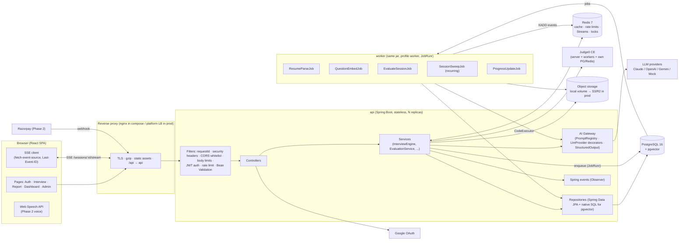
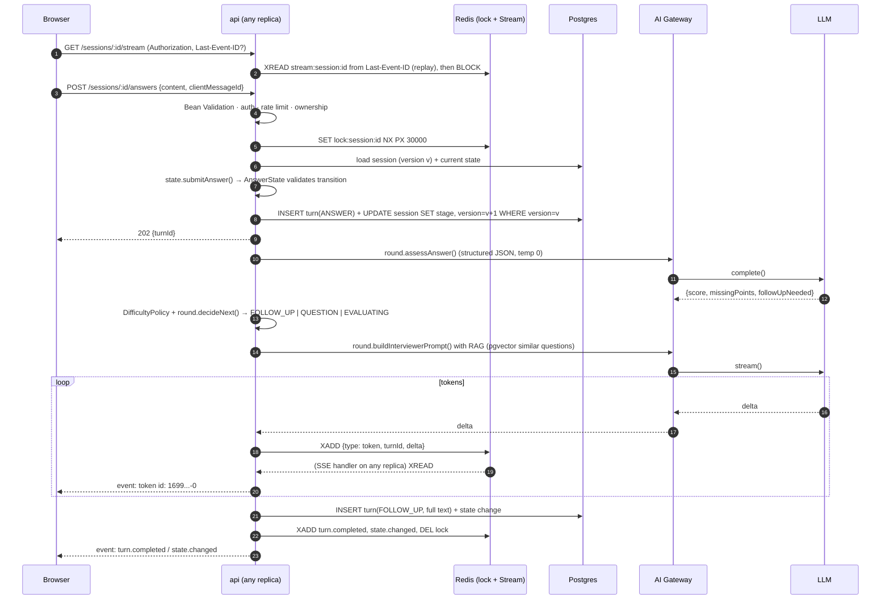
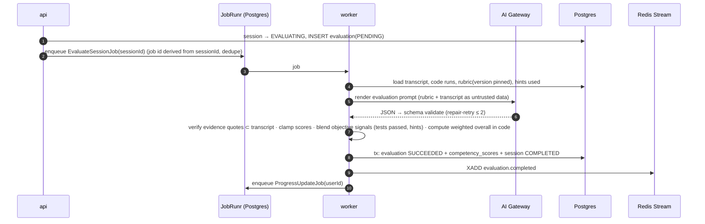

# 02 · Architecture

## 1. Chosen stack (with reasons)

| Concern | Choice | Why | Trade-off accepted |
|---|---|---|---|
| Backend | **Java 25 LTS + Spring Boot 3.5 (Spring MVC on virtual threads)**, Maven Wrapper | Mature, strongly typed, and the dominant enterprise stack at Indian product companies (good for placements). Virtual threads (`spring.threads.virtual.enabled=true`) give simple blocking code with high concurrency for long LLM calls and SSE connections, without moving to WebFlux. | More boilerplate than Node. Spring Boot 4 is out, but 3.5 was chosen per the brief and for ecosystem maturity (springdoc, JobRunr, Testcontainers). |
| Persistence | **Spring Data JPA (Hibernate 6) + Flyway** | Explicit, reviewable SQL migrations, which are needed anyway for pgvector, HNSW and partial indexes. JPA for aggregates, native queries for vector search and dashboard aggregations. | JPA pitfalls (N+1, lazy loading) are handled with `@EntityGraph`, DTO projections and `spring.jpa.open-in-view=false`. |
| Validation | **Jakarta Bean Validation** on request DTO records. **LLM output**: Java records → JSON Schema (victools generator) → validated with networknt `json-schema-validator`, then Bean Validation and semantic checks | One source of truth (the record) gives the prompt's schema, the validator and the typed object. | — |
| API docs | **springdoc-openapi** (Swagger UI). The frontend generates TypeScript types from `/v3/api-docs` with `openapi-typescript` | The API contract is typed end-to-end without a shared code package. | Generated types must be regenerated when the API changes, and CI checks this. |
| Security | **Spring Security 6**: stateless resource server (JWT HS256 via Nimbus) + custom rotating refresh tokens; Google OIDC code flow with PKCE | Standard, well-tested filters. | Refresh-token rotation is custom code, because Spring has no built-in support for SPAs. |
| Background jobs | **JobRunr** (PostgreSQL storage): retries with exponential backoff, recurring jobs, dashboard. The **worker** is the same jar run with profile `worker` | No extra broker. Jobs are durable in PG. The dashboard is useful in demos. | JobRunr OSS lacks some Pro features (batches, rate-limited queues), which aren't needed. |
| Events | Spring `ApplicationEventPublisher` + `@TransactionalEventListener(AFTER_COMMIT)` | Observer pattern with transaction-aware delivery. | In-process only. Durability comes from listeners that enqueue JobRunr jobs, plus the sweeper (see LLD §6). |
| Frontend | **React 19 + Vite 7 + TypeScript 5.9 + Tailwind + TanStack Query + React Router** (npm) | An SPA is enough, since only the public report needs SEO. Vite gives fast dev builds. | No SSR. |
| Editor | `@monaco-editor/react`, `mermaid` for LLD preview | Industry-standard editor. Mermaid is text-based, so the LLM can read diagrams as plain text. | Monaco bundle size is mitigated by lazy-loading the route. |
| DB | **PostgreSQL 16 + pgvector 0.8** (HNSW index), `hibernate-vector` for the column mapping | Relational core plus vector search in one store, so there is no extra vector DB to operate. | Fine up to ~1M vectors, far beyond need. |
| Cache / limits / streams | **Redis 7** (Spring Data Redis, Lettuce): cache, rate limits (atomic **Lua token bucket** on the Redis clock), **Redis Streams** for SSE fan-out and replay, per-session locks | Streams give ordered, replayable events with IDs, which is exactly what `Last-Event-ID` needs. | Redis becomes critical, so the design degrades gracefully (see §6). |
| Resilience | **Resilience4j** (CircuitBreaker, Retry, TimeLimiter) used *inside* our own decorator classes | Proven primitives with Micrometer metrics built in. Our decorators keep the pattern explicit. | — |
| Code execution | **Judge0 CE 1.13.x** self-hosted (compose profile `judge0`), behind a `CodeExecutor` Strategy | Isolate-based sandbox with CPU, memory and network limits. | Needs privileged containers and cgroup v1. See [09-risks.md](09-risks.md) R6 (this machine reports cgroup v2). |
| LLM | `LlmProvider` Strategy with adapters over the official Java SDKs (Anthropic, OpenAI, Google GenAI) + **Mock**. Defaults: `claude-haiku-5-5` for interviewer turns, `claude-sonnet-5-5` for evaluation and extraction; configurable by env | Provider-agnostic, testable, swappable at runtime. | Lowest-common-denominator interface. Provider-specific features live inside adapters. |
| Embeddings | `EmbeddingProvider` Strategy: OpenAI `text-embedding-3-small` (dimensions=1024), Gemini `gemini-embedding-001` (1024), Voyage, **Mock** (feature hashing, 1024-d, deterministic) | A fixed 1024-d column works across providers. `embedding_model` is stored per row, so a reindex job can migrate. | Mock similarity is lexical, not semantic, which is fine for demos and tests. |
| Templates | JMustache for prompt files (front-matter + body) | Logic-less templates keep prompts reviewable. | — |
| PDF | Apache PDFBox 3 | Robust text extraction, page count, encrypted-PDF detection. | — |
| Payments | Razorpay Subscriptions (test mode) behind a `PaymentProvider` Strategy (+ Mock) | Required by the brief, and the Indian market fits. | Webhooks need a public URL (ngrok/cloudflared in dev). |
| Observability | Spring Boot structured logging (JSON, `logstash` format) in containers, with MDC `requestId`/`userId`/`sessionId`; **Actuator** health groups (liveness/readiness) + **Micrometer Prometheus** | Standard and cheap. Resilience4j, Hikari, JVM and HTTP metrics come for free. | No tracing backend. Micrometer Tracing / OpenTelemetry is a documented next step. |
| Tests | **JUnit 5, Mockito, AssertJ, Testcontainers** (`@ServiceConnection` pgvector + Redis), MockMvc, **WireMock** (LLM and Judge0 HTTP), **ArchUnit** (layering); web: Vitest + RTL + MSW; **Playwright** E2E | Real infrastructure in integration tests, and no paid API calls in CI. | Integration tests need Docker running. |

## 2. System context and containers

### Component responsibilities

| Component | Responsibility | Key design notes |
|---|---|---|
| **Web SPA** | UI, Monaco/Mermaid editors, charts (Recharts), SSE consumption, token refresh. API types generated from OpenAPI. | Access token kept in memory. A 401 triggers a single-flight refresh, then the request is retried. React Query handles server state. The stream hook dedupes by event id. |
| **Reverse proxy** | Serves the built SPA and proxies `/api`. Disables buffering for SSE (`X-Accel-Buffering: no`). | In prod: Vercel for the SPA, Render/Railway for the API. |
| **api** | HTTP boundary (Spring MVC, profile `api`). Validates everything with Bean Validation. Orchestrates domain services. Owns the interview state machine. Streams LLM tokens. | Stateless. All session state is in PG; ephemeral stream state is in Redis. Any replica can serve any request. |
| **worker** | Long or retryable work: resume parsing, embeddings, evaluation, sweeper, progress aggregation. | Same jar, profile `worker` (no web server except actuator). JobRunr gives retries with exponential backoff, a failed-jobs view, recurring jobs and per-server worker counts. |
| **AI Gateway** | Single entry for every LLM call: render a versioned prompt → call the provider through decorators (budget → cache → circuit breaker → retry → timeout → metering) → validate JSON against the schema → repair-retry. | Logs every call to `ai_call_logs` (tokens, latency, cache hit, prompt version). Never logs raw resume text. |
| **PostgreSQL** | System of record: users, questions + embeddings, sessions, turns, evaluations, rubrics, billing. | HNSW index on `questions.embedding`. Optimistic locking on `interview_sessions.version`. |
| **Redis** | (1) prompt/result cache, (2) Bucket4j rate-limit buckets, (3) `stream:session:{id}` event log (MAXLEN ~ 2000, TTL 24 h), (4) per-session mutex for transitions, (5) OAuth `state`/PKCE verifier (TTL 10 min). | Key prefixes and TTLs documented in code. |
| **Judge0** | Sandboxed compilation and execution of candidate code. | Reached only from api/worker on an internal Docker network. Never exposed publicly. Calls are batched (`/submissions/batch`) and polled. |
| **Object storage** | Resume PDFs. | Local Docker volume in dev. S3-compatible interface (`FileStorage` Strategy) for prod. Files are named by UUID, never by the user-supplied name. |

## 3. Key data flows

### 3.1 Answer → follow-up, streamed (the core loop)

**Why Redis Streams rather than writing tokens straight to the HTTP response?** The POST that triggers
generation and the GET that holds the SSE connection can land on different replicas. After a reconnect, the
client must get missed tokens. Streams give both: decoupled producers and consumers, and replay by event id.
The SSE response sends a `heartbeat` comment every 15 s to keep proxies from closing idle connections.

### 3.2 Session end → evaluation (async)

On job failure, JobRunr retries 3× with exponential backoff (10 s, 40 s, 160 s). The final failure marks the
evaluation `FAILED` and the session stays `EVALUATING`. The user sees "Retry", and admins see it in the failed set.

### 3.3 Resume upload

`POST /resumes` (multipart, `spring.servlet.multipart.max-file-size=5MB`, magic-byte check) → store file → `resumes` row `UPLOADED`
→ enqueue `ResumeParseJob` → worker extracts text with PDFBox (page cap 10), normalises whitespace,
truncates to 20k chars → `ResumeExtraction` prompt with the text wrapped as untrusted data → validated
`ParsedResume` record → `PARSED` + `resume_projects` rows → stream/poll status to the UI.

### 3.4 Code run (DSA)

`POST /sessions/:id/code/run` → validate language and size → `CodeExecutor.runBatch(source, tests)`
→ Judge0 `/submissions/batch?base64_encoded=true` → poll tokens (200 ms → 1 s backoff, 15 s overall timeout)
→ map Judge0 status ids to our `ExecutionVerdict` → persist `code_submissions` → respond `200` with results
(hidden test details redacted). The result is also appended as a `CODE_RUN` turn so the interviewer and the
evaluator can see it.

**Harness approach:** a DSA question stores a language-specific *driver template* (reads stdin, calls the
candidate's function, prints JSON). The candidate writes only the function, as on LeetCode. The executor
concatenates driver + candidate code server-side. Comparison is done on normalised JSON output.

## 4. Cross-cutting concerns

| Concern | Approach |
|---|---|
| **Request validation** | Every request body is a DTO `record` with Bean Validation annotations (`@Valid`). Path and query params are validated with `@Validated`. Failures return `400 VALIDATION_ERROR` with field paths. A filter enforces a 100 KB JSON body limit (code endpoints 128 KB, uploads 5 MB via multipart config). |
| **Errors** | `AppException` hierarchy carrying an `ErrorCode` (`NotFound`, `Conflict`, `InvalidTransition`, `QuotaExceeded`, `UpstreamUnavailable`…) → one `@RestControllerAdvice` → RFC 7807 `ProblemDetail` (`application/problem+json`) with `code` and `requestId`. Unknown errors become 500 without leaking stack traces. |
| **Security headers** | Spring Security headers (CSP `default-src 'none'` for API responses, HSTS in prod, `nosniff`, frame deny, referrer policy). CORS whitelist from `CORS_ORIGINS`. `credentials: true` only for listed origins. |
| **AuthZ** | Security filter chain (`/api/v1/admin/**` → `hasRole('ADMIN')`), `@PreAuthorize` where useful, and resource ownership checks in services (never trust ids from the client). |
| **Rate limiting** | A Lua token-bucket script in Redis (one atomic round trip, Redis server clock so all replicas agree), behind a `RateLimiter` Strategy, keyed by user (or IP when anonymous) and route class. Classes: `auth` 5/min/IP+email, `ai` 12/min/user, `code` 20/min/user, `default` 120/min/user. Returns `429` + `Retry-After` + `RateLimit-*` headers. |
| **LLM cost controls** | Per-session token budget (default 60k in / 15k out for MVP; stored on session). Per-user daily budget. Cache identical temperature-0 calls (sha256 of provider+model+prompt id/version+messages+params) for 24 h. Max output tokens per prompt in its front-matter. |
| **Resilience** | Timeouts (interviewer stream: 10 s to first token, 60 s total; evaluation: 90 s), retries with exponential backoff + full jitter (only on 429/5xx/timeouts, max 3), circuit breaker per provider (opens at 50% failures over 20 calls / 30 s, half-open after 30 s), optional fallback provider chain. |
| **Observability** | `RequestIdFilter` puts `requestId` (from `X-Request-Id` or generated) into the MDC. It is propagated into JobRunr job parameters and AI call logs, and logged as JSON. Metrics: HTTP latency histogram, LLM latency/tokens/cost-units by provider+purpose, cache hit ratio, breaker state, queue depth, Judge0 latency. |
| **Config** | Typed `@ConfigurationProperties` records with `@Validated` fail fast at boot with a readable error. `.env.example` documents every variable. |
| **Data protection** | Resume text and transcripts are PII. They are never logged (DTO `toString()` masks them, and a Logback masking pattern acts as a backstop) and are deletable by the user (`DELETE /me` cascades). Public share view redacts PII. |

## 5. Deployment topology

| Env | Topology |
|---|---|
| **Local** | `docker compose up --build`: `web` (nginx + built SPA, :8088→80), `api` (:8080), `worker` (from Phase 4), `postgres` (pgvector/pgvector:pg16), `redis` (7-alpine). Flyway migrations run on api startup, and the worker waits for api health. Profile `judge0`: `judge0-server`, `judge0-workers`, `judge0-db`, `judge0-redis`. Healthchecks gate `depends_on`. |
| **CI** | GitHub Actions: backend `./mvnw verify` (unit + Testcontainers integration + ArchUnit + JaCoCo); frontend lint → typecheck → test → build; docker build → Playwright E2E against compose with `AI_PROVIDER=mock` and `CODE_EXECUTOR=mock`. GitHub runners use cgroup v2, which Judge0 1.13 does not support (see R6). The mock executor is clearly labelled, never runs code, and refuses to boot when `NODE_ENV=production`. Real-Judge0 contract tests are tagged `@judge0` and run locally or on a self-hosted runner. |
| **Prod (guide)** | Web → Vercel. API + worker → Render or Railway (two services, same image). Postgres → Railway/Neon (pgvector enabled). Redis → Railway Redis or Upstash (Streams and Lettuce need a full RESP Redis, not the HTTP API). Judge0 → a small VM (e.g. a 2 vCPU droplet) with Docker, reachable over a private network or an IP allowlist with an auth token, *or* hosted Judge0 CE on RapidAPI via the same `Judge0Executor` using a different base URL and header. |

## 6. Failure modes and degradation

| Failure | Behaviour |
|---|---|
| LLM provider down | Circuit opens → a fallback provider is used if configured. Otherwise the interviewer shows "AI interviewer is temporarily unavailable — your progress is saved", the session stays in its state and the user can retry. Evaluation jobs retry later. |
| Judge0 down | `503 CODE_EXECUTOR_UNAVAILABLE`. The candidate can still explain the approach. The evaluator is told tests could not run and scores code correctness as "not measurable". |
| Redis down | Readiness fails, so the LB stops routing. Rate limiter fails **closed** for AI routes and **open** for reads. SSE clients reconnect and reload state from PG. |
| Postgres down | Readiness fails. 503 for all writes. |
| Worker backlog | The evaluation shows its status via `evaluation.progress` events. Workers scale horizontally (JobRunr coordinates through PG). |

## 7. As built (v1.0.0): deviations from this design

The design above was written before implementation. These are the places where the shipped code differs, and why.
The design sections are kept as written so the reasoning stays visible.

| Designed | Built | Why |
|---|---|---|
| JobRunr + a separate `worker` container | Effects run in-process on a virtual-thread executor after the transaction commits. An `InterviewSweeper` (`@Scheduled`, every 30 s) recovers stuck generation (> 2 min), idle sessions (30 min → evaluate or abandon) and stalled evaluations (max 3 attempts). | One deployable and no extra dependency. The engine's state lives in Postgres, so a crash loses at most an in-flight AI call, and the sweeper turns that into a retryable error. A durable queue is listed as the next step. |
| Per-session Redis mutex for transitions | Optimistic locking (`@Version`) on `interview_sessions` with automatic retry on conflict (also on unique-key races for turn `seq` / `client_message_id`). | Same safety with fewer moving parts; conflicts are rare (one user per session). |
| Object storage (`FileStorage` Strategy, S3 in prod) for resume PDFs | PDFs are stored in `resumes.content` (`bytea`) and never mapped on the JPA entity (read only by the parser via JDBC). | ≤ 5 MB × ≤ 5 resumes per user is small. Deleting the row deletes the file, which makes "hard delete on request" trivially correct. |
| Type-specific detail tables (`dsa_problems`, …) | One `questions` table with a `detail jsonb` column, validated per type at the boundary (`QuestionAdminService.validateDetail`) and read through typed records. | One query path for search, embeddings and admin CRUD; validation in one place. |
| Bucket4j rate limiting | A Redis Lua token bucket (since Phase 2); code runs have their own bucket (20/min/user) in `InterviewService`. | One atomic round trip on the Redis server clock. |
| `GET /sessions/{id}/report` returns 202 while evaluating | Always 200 with `evaluation.status` (`PENDING`/`RUNNING`/`FAILED`/`SUCCEEDED`); 409 only for abandoned/unfinished sessions. | One response type for the client; the status drives polling. |
| Fallback provider chain | A single configured provider behind the decorator chain; when the circuit is open the session stays put and the candidate retries. | The mock is the offline fallback for development; a second paid provider was out of scope. |
| Judge0 contract tests tagged `@judge0` | Judge0 is tested with WireMock (`Judge0CodeExecutorTest`). The generated drivers are verified by running all 30 reference solutions locally (`HarnessRoundTripTest`; Python and JS via local interpreters, Java via `javax.tools`; the C++ driver is not executed locally because no C++ compiler is assumed). | Judge0 cannot run on cgroup-v2 CI runners (R6); this still proves the harness end to end. |
