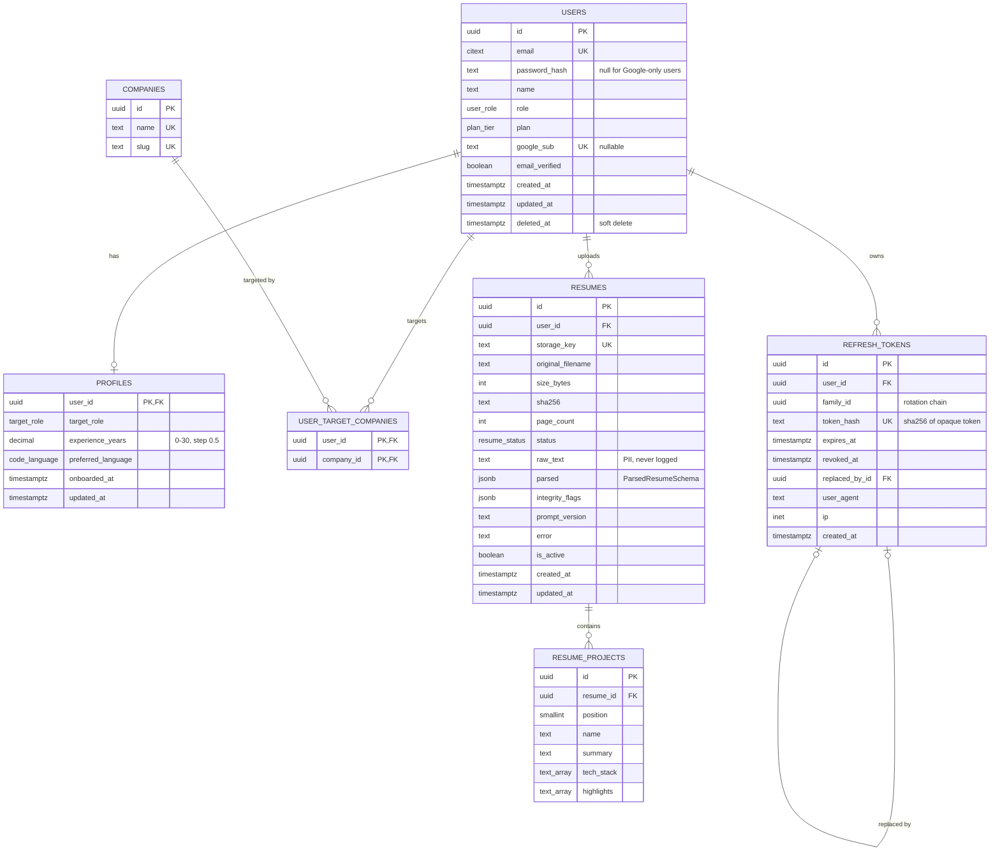
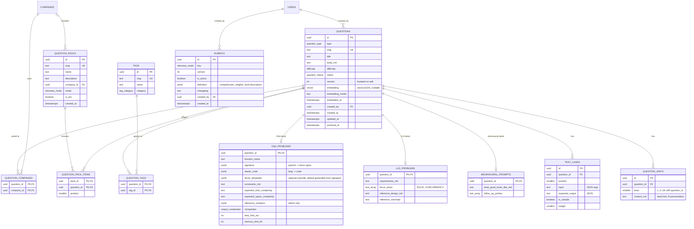
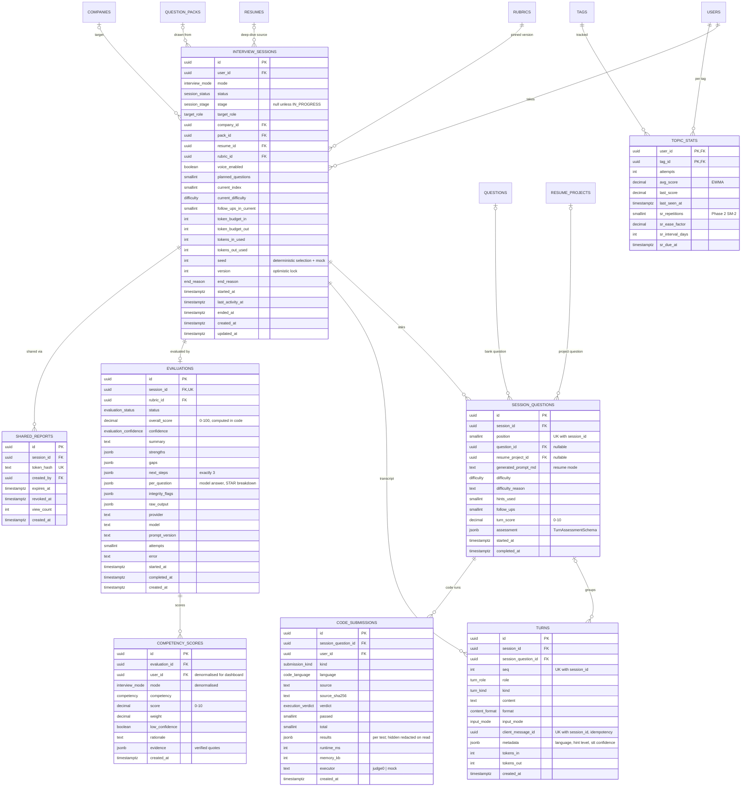
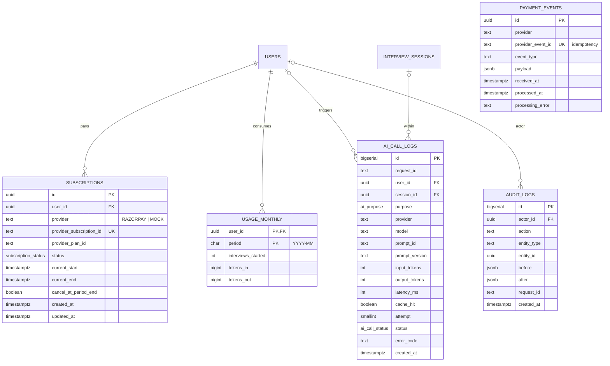

# 03 · Data Model (ER)

PostgreSQL 16 with extensions `pgvector`, `citext` and `pgcrypto`. All primary keys are `uuid` (`gen_random_uuid()`)
except append-only log tables (`bigserial`). Timestamps are `timestamptz`. Schema is owned by **Flyway** SQL migrations. JPA entities
are PascalCase mapped to snake_case tables (`@Table`), and Hibernate runs with `ddl-auto=validate`, so entity/schema
drift fails at startup.

The diagram is split into four domains for readability. Relationships across domains are repeated as stubs.

> These are the design-time diagrams. The shipped schema (migrations `V1`–`V5`, 21 tables) differs in places, for
> example one `questions` table with a `detail` jsonb column instead of per-type tables. The ER diagram of the
> shipped schema is in [10-architecture-and-er-diagrams.md](10-architecture-and-er-diagrams.md#6-er-diagram).

## 1. Identity, profile and resume

## 2. Question bank, packs and rubrics

## 3. Sessions, evaluation and progress

## 4. Billing, usage and operations

> `text_array` in the diagrams means PostgreSQL `text[]`, and `vector` means `vector(1024)`. Mermaid's ER
> syntax doesn't accept those type spellings.

## 5. Enums

| Enum | Values |
|---|---|
| `user_role` | USER, ADMIN |
| `plan_tier` | FREE, PRO |
| `target_role` | SDE_1, SDE_2 |
| `code_language` | PYTHON, JAVA, CPP, JAVASCRIPT |
| `resume_status` | UPLOADED, PARSING, PARSED, FAILED |
| `question_type` | DSA, LLD, BEHAVIOURAL |
| `difficulty` | EASY, MEDIUM, HARD |
| `question_status` | DRAFT, PUBLISHED, ARCHIVED |
| `tag_category` | DSA_TOPIC, LLD_CONCEPT, BEHAVIOURAL_COMPETENCY, LEADERSHIP_PRINCIPLE, TECH_SKILL |
| `output_comparator` | EXACT, UNORDERED_LIST, FLOAT_TOLERANCE |
| `interview_mode` | DSA, LLD, BEHAVIOURAL, RESUME_DEEP_DIVE |
| `session_status` | CREATED, IN_PROGRESS, EVALUATING, COMPLETED, ABANDONED |
| `session_stage` | QUESTION, ANSWER, FOLLOW_UP |
| `end_reason` | COMPLETED_ALL, ENDED_BY_USER, INACTIVITY, ABANDONED_BY_USER, BUDGET_EXHAUSTED |
| `turn_role` | INTERVIEWER, CANDIDATE, SYSTEM |
| `turn_kind` | QUESTION, ANSWER, FOLLOW_UP, HINT, CODE_RUN, CLARIFICATION, SYSTEM_NOTICE |
| `content_format` | TEXT, MARKDOWN, CODE, MERMAID |
| `input_mode` | TEXT, VOICE |
| `submission_kind` | RUN, SUBMIT |
| `execution_verdict` | ACCEPTED, WRONG_ANSWER, TIME_LIMIT_EXCEEDED, MEMORY_LIMIT_EXCEEDED, RUNTIME_ERROR, COMPILATION_ERROR, INTERNAL_ERROR |
| `evaluation_status` | PENDING, RUNNING, SUCCEEDED, FAILED |
| `evaluation_confidence` | HIGH, MEDIUM, LOW |
| `competency` | PROBLEM_SOLVING, CODE_QUALITY, COMMUNICATION, DESIGN, EDGE_CASES |
| `ai_purpose` | INTERVIEWER_TURN, TURN_ASSESSMENT, HINT, RESUME_EXTRACTION, QUESTION_GENERATION, EVALUATION, EVALUATION_REPAIR, EMBEDDING |
| `ai_call_status` | OK, ERROR, TIMEOUT, CIRCUIT_OPEN, BUDGET_EXCEEDED, INVALID_OUTPUT |
| `subscription_status` | CREATED, AUTHENTICATED, ACTIVE, PENDING, HALTED, CANCELLED, COMPLETED, EXPIRED (mirrors Razorpay) |

**Competency applicability per mode** (rubric decides weights; weight 0 = N/A, shown as "—" in the report):

| Competency | DSA | LLD | Behavioural | Resume |
|---|---|---|---|---|
| PROBLEM_SOLVING | 0.30 | 0.20 | 0.25 | 0.20 |
| CODE_QUALITY | 0.20 | 0.15 | — | 0.15 |
| COMMUNICATION | 0.20 | 0.20 | 0.45 | 0.30 |
| DESIGN | 0.10 | 0.35 | — | 0.25 |
| EDGE_CASES | 0.20 | 0.10 | 0.30 (as "Result & impact") | 0.10 |

Behavioural also stores S/T/A/R sub-scores per answer in `evaluations.per_question`. These roll up into
PROBLEM_SOLVING (Task + Action), COMMUNICATION (structure and clarity) and EDGE_CASES, which the behavioural
rubric relabels as "Result & impact".

## 6. Indexes and constraints

| Table | Index / constraint | Purpose |
|---|---|---|
| users | `UNIQUE(email)` (citext), `UNIQUE(google_sub) WHERE google_sub IS NOT NULL` | login lookup |
| refresh_tokens | `UNIQUE(token_hash)`, `INDEX(user_id)`, `INDEX(family_id)` | refresh, family revoke |
| resumes | `INDEX(user_id, created_at DESC)`, `UNIQUE(user_id) WHERE is_active` | latest active resume |
| questions | `INDEX(type, status, difficulty)` | session question selection |
| questions | `HNSW (embedding vector_cosine_ops) WITH (m=16, ef_construction=64)` | similar-question search |
| questions | `INDEX USING GIN (to_tsvector('english', title \|\| ' ' \|\| body_md))` | admin and user search |
| question_tags | `INDEX(tag_id)` | filter by tag |
| question_hints | `UNIQUE(question_id, level)`, `CHECK(level BETWEEN 1 AND 3)` | graded hints |
| test_cases | `INDEX(question_id, is_sample, position)` | run samples vs all |
| rubrics | `UNIQUE(key, version)`, partial `UNIQUE(key) WHERE is_active` | one active version per mode |
| interview_sessions | `INDEX(user_id, created_at DESC)` | history list |
| interview_sessions | `INDEX(status, last_activity_at) WHERE status = 'IN_PROGRESS'` | inactivity sweeper |
| session_questions | `UNIQUE(session_id, position)` | ordering |
| turns | `UNIQUE(session_id, seq)`, `UNIQUE(session_id, client_message_id)` | ordering + idempotency |
| code_submissions | `INDEX(session_question_id, created_at)` | latest run |
| evaluations | `UNIQUE(session_id)` | one evaluation per session |
| competency_scores | `UNIQUE(evaluation_id, competency)`, `INDEX(user_id, competency, created_at)` | dashboard trends |
| topic_stats | `INDEX(user_id, avg_score)`, `INDEX(user_id, sr_due_at)` | weak topics, revision queue |
| ai_call_logs | `INDEX(user_id, created_at)`, `INDEX(session_id)`, `BRIN(created_at)` | budget queries, analytics |
| subscriptions | `UNIQUE(provider_subscription_id)`, `INDEX(user_id, status)` | webhook lookup |
| payment_events | `UNIQUE(provider_event_id)` | webhook idempotency |
| shared_reports | `UNIQUE(token_hash)` | public lookup |
| all score columns | `CHECK (score BETWEEN 0 AND 10)` / `CHECK (overall_score BETWEEN 0 AND 100)` | integrity |

## 7. Modelling decisions

1. **Type-specific detail tables** (`dsa_problems`, `lld_problems`, `behavioural_prompts`) instead of one wide
   nullable table or pure JSONB. Common fields are queryable and indexed, specific fields are validated, and
   adding a new question type adds a new table without breaking existing ones.
2. **Rubrics versioned as immutable rows** with `definition jsonb` validated against the `RubricDefinition` record (Bean Validation + weight-sum check) on write. Sessions
   pin `rubric_id`, so historical reports remain reproducible after a rubric change.
3. **Overall score is never trusted from the LLM.** It is computed in code as `Σ(weight × score) / Σ(weight) × 10`,
   and only applicable competencies count.
4. **Denormalised `user_id` and `mode` on `competency_scores`** so the dashboard trend query reads one index
   without joining sessions → evaluations.
5. **Turns are append-only** with a per-session `seq`. The transcript is the audit trail used by evaluation.
6. **pgvector**: the entity maps `embedding` with `hibernate-vector` (`@JdbcTypeCode(SqlTypes.VECTOR) @Array(length = 1024) float[]`).
   Similarity search is a parameterised native query (`<=>` cosine) in `QuestionEmbeddingRepository`, the only place
   that touches vector SQL.
7. **Soft delete** for users and questions (archive). **Hard delete** for resumes on user request (privacy).
   Deleted users are also **anonymised** (email rewritten to `deleted+<id>@deleted.invalid`, name, password
   hash and Google subject cleared), so the original address can register again and no personal data remains.
8. **Enums are `text` + `CHECK` constraints, not PostgreSQL `ENUM` types** (implemented in Phase 2). Adding a
   value is a constraint change inside a normal transactional migration, and values can be removed. PG enums
   allow neither cleanly. The diagrams keep enum names for readability.
9. **`refresh_tokens.ip` is `text` (≤ 45 chars, fits IPv6)** rather than `inet`: it is only displayed and
   audited, never range-queried, so the simpler mapping wins.
10. **Optimistic locking**: `users.version` (JPA `@Version`) guards concurrent admin edits.
