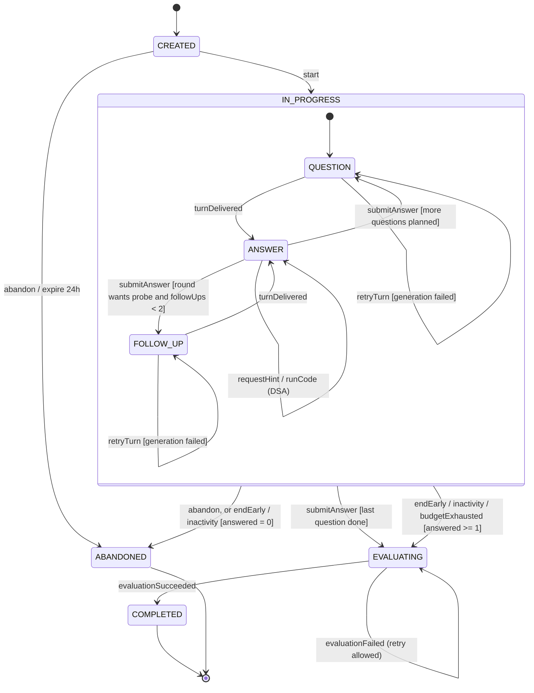
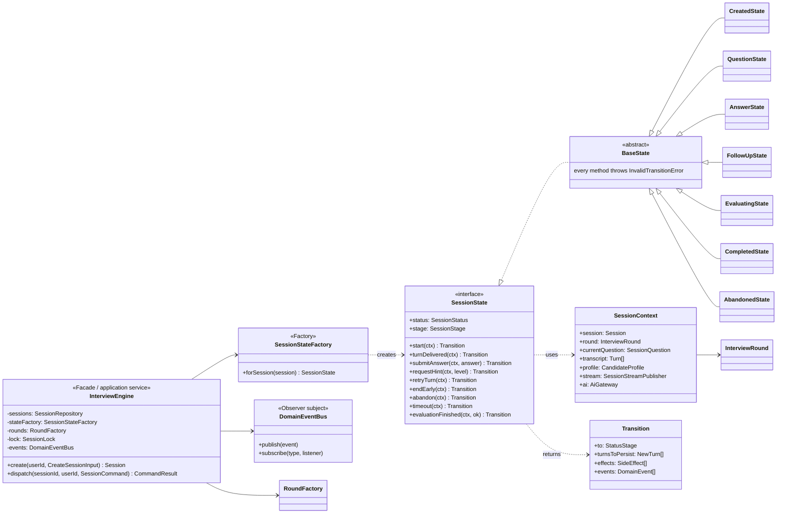
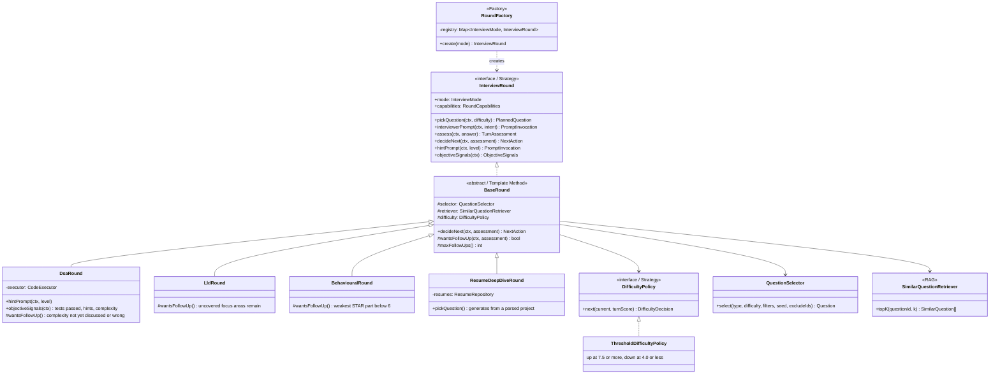
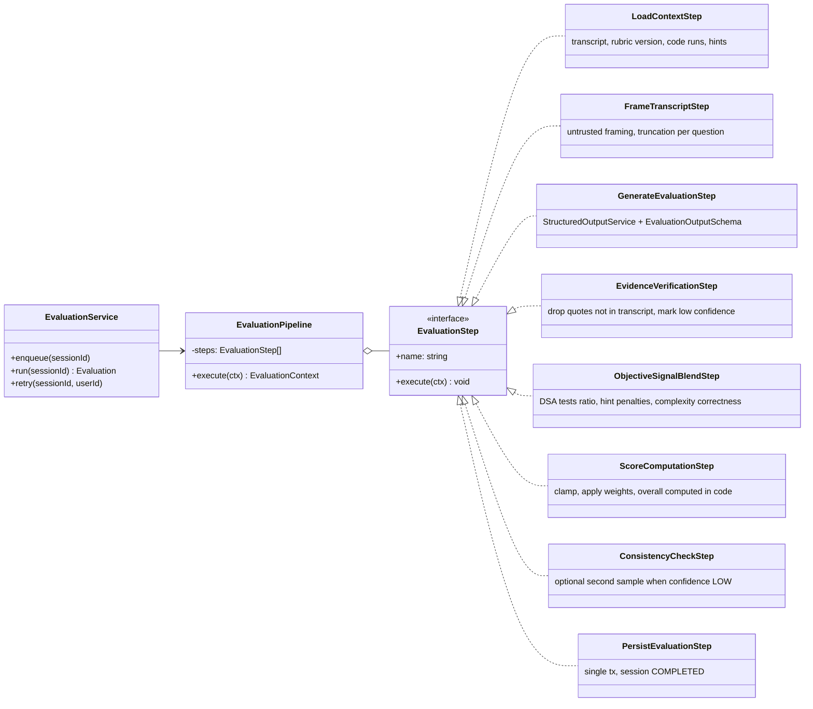
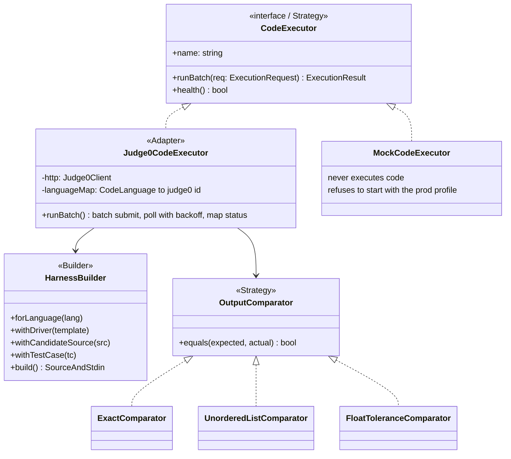

# 04 · Low-Level Design

This document covers the four parts of the backend with real design weight: the **interview engine**
(State + Strategy + Factory), the **AI provider abstraction** (Strategy + Decorator + Factory + Facade), the
**evaluation pipeline** (Chain of Responsibility / pipeline), and **code execution** (Strategy + Builder +
Adapter). The Java snippets are interface sketches that fix the contracts. They are not implementation.

Dependency injection uses Spring with **constructor injection only** (no field injection). Strategy
implementations are collected by Spring (`List<InterviewRound>`, `Map<String, LlmProvider>`) and indexed by
the factories. Decorator chains are assembled explicitly in a `@Configuration` class so their order is visible
and testable. Unit tests construct classes directly with fakes and need no Spring context.

## 1. Interview session state machine



The PG columns `status` and `stage` together encode the hierarchical state. `stage` is non-null only when
`status = IN_PROGRESS`.

### Transition table (source of truth for tests)

| From | Event | Guard | To | Side effects |
|---|---|---|---|---|
| CREATED | `start` | owner; quota available | IN_PROGRESS/QUESTION | `usage_monthly++`; round picks Q1; stream question |
| QUESTION | `turnDelivered` | generation finished | ANSWER | persist QUESTION turn |
| QUESTION / FOLLOW_UP | `retryTurn` | no generation lock held | same | re-run generation (recovers from LLM failure) |
| ANSWER | `submitAnswer` | size ok; budget ok; idempotency key unseen | FOLLOW_UP · QUESTION · EVALUATING | persist ANSWER turn → `round.assess()` → `DifficultyPolicy` → `round.decideNext()` |
| ANSWER | `requestHint(level)` | DSA; `level = hintsUsed + 1 ≤ 3` | ANSWER | HINT turn streamed; `hints_used++` |
| ANSWER | `runCode` / `submitCode` | DSA | ANSWER | CODE_RUN turn |
| FOLLOW_UP | `turnDelivered` | | ANSWER | persist FOLLOW_UP turn |
| IN_PROGRESS.* | `endEarly` | answered ≥ 1 ⇒ EVALUATING, else ABANDONED | EVALUATING / ABANDONED | `SessionEnded` event |
| IN_PROGRESS.* | `abandon` | | ABANDONED | |
| IN_PROGRESS.* | `inactivityTimeout` (sweeper, 30 min) | as endEarly | EVALUATING / ABANDONED | `end_reason = INACTIVITY` |
| IN_PROGRESS.* | `budgetExhausted` | token budget hit | EVALUATING | `end_reason = BUDGET_EXHAUSTED`; system notice turn |
| EVALUATING | `evaluationSucceeded` | | COMPLETED | `EvaluationCompleted` event |
| EVALUATING | `evaluationFailed` | | EVALUATING | evaluation `FAILED`; user may retry |
| any other | any other | | — | `409 INVALID_TRANSITION` |

**Concurrency control (two layers).**
1. *Redis mutex* `lock:session:{id}` (SET NX PX 30 s, token-checked release) serialises commands per session
   across replicas and stops double-submits while the LLM runs.
2. *Optimistic lock* on `interview_sessions.version`: every transition writes
   `UPDATE … SET …, version = version + 1 WHERE id = $1 AND version = $2`. A 0-row update means
   `409 STATE_CONFLICT`. This guards correctness even if the Redis lock expires mid-operation.

### Engine class diagram — State + Factory + Strategy + Observer



**Flow of `dispatch()`.** The engine acquires the lock, loads the session and builds `SessionContext`,
asks `SessionStateFactory` for the state object, and calls the command method. The state returns a
`Transition`, which is a *description* of what should happen, not the act of doing it. The engine then
persists the turns and the state change in one PG transaction with the version check, publishes events,
runs post-commit effects (streaming generation), and releases the lock.

Keeping states free of I/O-committing logic makes every transition unit-testable with a fake context.
The transition table above becomes a table-driven test.

```java
// Sketch — contracts only (Java 25 sealed types + records; pattern-matching switch in the engine)
public sealed interface SessionCommand {
    record Start() implements SessionCommand {}
    record SubmitAnswer(UUID clientMessageId, String content, ContentFormat format,
                        InputMode inputMode, CodeAnswer code, String mermaid) implements SessionCommand {}
    record RequestHint(int level) implements SessionCommand {}
    record RetryTurn() implements SessionCommand {}
    record EndEarly() implements SessionCommand {}
    record Abandon() implements SessionCommand {}
    record Timeout() implements SessionCommand {}
}

public sealed interface SideEffect {
    record GenerateTurn(TurnIntent intent, Integer hintLevel) implements SideEffect {}
    record EnqueueEvaluation() implements SideEffect {}
    record Notify(StreamEvent event) implements SideEffect {}
}
```

## 2. Interview rounds — Strategy + Template Method + Factory



**`BaseRound.decideNext()` (template method):**

```
if assessment.followUpRecommended and followUpsInCurrent < maxFollowUps() and wantsFollowUp(ctx, a):
    return FOLLOW_UP(focus = a.missingPoints[0])
if currentIndex + 1 < plannedQuestions and budget remains:
    nextDifficulty = difficulty.next(current, a.score)        // adaptive difficulty
    return NEXT_QUESTION(nextDifficulty, reason)
return FINISH
```

**Per-turn assessment** (`assess`) is a cheap, temperature-0, schema-validated call (`turn-assessment.v1`). It
returns `{score 0–10, coveredPoints[], missingPoints[], followUpRecommended, followUpFocus, integrityFlags[]}`.
It drives adaptivity only. The final report always comes from the full evaluation pipeline, so per-turn
noise does not leak into final scores. For DSA, the turn score blends `0.6 × AI score + 0.4 × 10 × testPassRatio`
with hint penalties.

**Question selection.** `QuestionSelector` filters `PUBLISHED` questions by type, difficulty, pack, company and
target role. It excludes questions the user has seen in the last 30 days, then picks with a seeded PRNG
(`session.seed + position`). Results are reproducible in tests and in mock demos. If the filter set is empty
it relaxes constraints in a fixed order: company → difficulty ±1 → seen-exclusion.

**RAG for follow-ups.** `SimilarQuestionRetriever` takes the current question's embedding, finds the top-3
neighbours (HNSW, cosine), and passes their titles plus `what_good_looks_like` or focus areas into the
follow-up prompt as *reference material*. This grounds probes in curated content instead of model memory.

## 3. AI provider abstraction — Strategy + Decorator + Factory + Facade

```mermaid
classDiagram
  direction TB

  class AiGateway {
    <<Facade>>
    +streamChat(invocation, ctx) AsyncIterable~TextDelta~
    +generateStructured(invocation, schema, ctx) T
    +embed(texts, ctx) number[][]
  }

  class LlmProvider {
    <<interface / Strategy>>
    +name: string
    +complete(req, opts) LlmResult
    +stream(req, opts) AsyncIterable~LlmStreamEvent~
  }
  class AnthropicProvider {
    <<Adapter>>
  }
  class OpenAiProvider {
    <<Adapter>>
  }
  class GeminiProvider {
    <<Adapter>>
  }
  class MockLlmProvider {
    -scenarios: MockScenarioRegistry
    deterministic, seeded, realistic
  }

  class LlmProviderDecorator {
    <<abstract / Decorator>>
    #inner: LlmProvider
  }
  class TimeoutDecorator
  class RetryDecorator {
    exp backoff + full jitter, retry only 429, 5xx, timeout
  }
  class CircuitBreakerDecorator {
    CLOSED, OPEN, HALF_OPEN
  }
  class CachingDecorator {
    Redis, temp 0 + non-stream only
  }
  class BudgetGuardDecorator {
    session + daily token budget
  }
  class MeteringDecorator {
    ai_call_logs + prom metrics
  }
  class FallbackProvider {
    <<Composite>> primary then secondary
  }

  class LlmProviderFactory {
    <<Factory>>
    +fromConfig(env) LlmProvider
  }

  class PromptRegistry {
    +get(id, version) PromptTemplate
  }
  class PromptTemplate {
    +id: string
    +version: string
    +purpose: AiPurpose
    +modelTier: fast or smart
    +temperature: number
    +maxTokens: number
    +outputSchema: string
    +render(vars) RenderedPrompt
  }
  class UntrustedContentFramer {
    +frame(label, text) string
    +detectInjection(text) IntegrityFlag[]
  }
  class StructuredOutputService {
    +generate(invocation, schema) T
    validate against JSON Schema, then repair-retry up to 2
  }

  class EmbeddingProvider {
    <<interface / Strategy>>
    +dimensions: int
    +embed(texts) number[][]
  }
  class OpenAiEmbeddings
  class GeminiEmbeddings
  class MockHashingEmbeddings

  AiGateway --> LlmProvider
  AiGateway --> PromptRegistry
  AiGateway --> StructuredOutputService
  AiGateway --> EmbeddingProvider
  PromptRegistry ..> PromptTemplate
  PromptTemplate ..> UntrustedContentFramer
  LlmProvider <|.. AnthropicProvider
  LlmProvider <|.. OpenAiProvider
  LlmProvider <|.. GeminiProvider
  LlmProvider <|.. MockLlmProvider
  LlmProvider <|.. LlmProviderDecorator
  LlmProvider <|.. FallbackProvider
  LlmProviderDecorator <|-- TimeoutDecorator
  LlmProviderDecorator <|-- RetryDecorator
  LlmProviderDecorator <|-- CircuitBreakerDecorator
  LlmProviderDecorator <|-- CachingDecorator
  LlmProviderDecorator <|-- BudgetGuardDecorator
  LlmProviderDecorator <|-- MeteringDecorator
  LlmProviderFactory ..> LlmProvider : builds chain
  EmbeddingProvider <|.. OpenAiEmbeddings
  EmbeddingProvider <|.. GeminiEmbeddings
  EmbeddingProvider <|.. MockHashingEmbeddings
```



**Decorator order** built by `LlmProviderFactory`. The outermost decorator runs first:

```
Metering → BudgetGuard → Caching → CircuitBreaker → Retry → Timeout → (Anthropic | OpenAI | Gemini | Mock)
```

- *Metering* is outermost so it records cache hits, budget rejections and breaker rejections too.
- *BudgetGuard* sits before the cache, so the budget check is cheap. Cache hits are charged 0 tokens.
- *Caching* sits before the breaker, so cached answers still serve while the provider is down.
- *Retry* sits inside the breaker, so one logical call counts as one breaker sample, not three.
- *Timeout* is per attempt.

Streaming calls skip the cache. Retry applies to streams only before the first token is emitted. After that,
a failure surfaces as an `error` stream event and the client may `retryTurn`.

```java
// Sketch — contracts only
public interface LlmProvider {
    String name();
    LlmResult complete(LlmRequest request, CallContext ctx);
    Stream<LlmStreamEvent> stream(LlmRequest request, CallContext ctx);   // consumed on a virtual thread
}
public record LlmRequest(String model, String system, List<ChatMessage> messages,
                         double temperature, int maxTokens, boolean json, List<String> stop) {}
public record LlmResult(String text, Usage usage, String model, FinishReason finishReason) {}
public sealed interface LlmStreamEvent {
    record Delta(String text) implements LlmStreamEvent {}
    record Done(Usage usage, FinishReason finishReason) implements LlmStreamEvent {}
}
public record CallContext(String requestId, UUID userId, UUID sessionId, AiPurpose purpose) {}
```

**Mock provider design.** `MockLlmProvider` is not a single canned string. A `MockScenarioRegistry` maps a
prompt id to a generator that reads the *rendered variables* and produces output, for example:
- `turn-assessment`: scores from simple heuristics (answer length, keyword coverage against expected
  points, STAR markers such as "situation", "I decided", "%", "result") so adaptivity visibly works;
- `evaluation`: builds a schema-valid report whose evidence quotes are real substrings of the transcript;
- `interviewer.*`: picks from curated, mode-specific follow-up templates filled with the candidate's terms.

All randomness uses a PRNG seeded by `sessionId + turnSeq`. Tokens stream in 2–6 character chunks with
15–40 ms jitter so the UI streaming path is exercised. The UI shows a persistent "Mock AI mode" badge.
The `AI_PROVIDER=mock` flag is the only way to enable it.

## 4. Evaluation pipeline — Chain of Responsibility (ordered steps) + Template Method



Each step reads from and writes to a shared `EvaluationContext`. Steps are individually unit-tested. Adding a
step (e.g. a "plagiarism similarity" check) means adding a class and leaves the others untouched (OCP).

**Score reliability rules (enforced in code, not prompt):**
1. The LLM returns *criterion-level* scores 0–10 with level descriptors from the rubric. It never returns the
   overall score.
2. Every competency must cite ≥ 1 evidence quote. Quotes are verified by normalised substring match against
   candidate turns. If none survive, `low_confidence = true` and the score is pulled toward the rubric
   midpoint: `score = 0.5 × score + 0.5 × 5`.
3. DSA correctness is objective. `EDGE_CASES` and `PROBLEM_SOLVING` are capped by the test pass ratio
   (e.g. 40% of hidden tests passing caps PROBLEM_SOLVING at 6).
4. Overall = weighted mean of applicable competencies × 10, rounded to 1 decimal, in code.
5. The `next_steps` array must have exactly 3 items, each with `action`, `resource_type` and a `why` linked to a gap.

## 5. Code execution — Strategy + Builder + Adapter



Judge0 status id → `execution_verdict`: 3 → ACCEPTED (then compared), 4 → WRONG_ANSWER, 5 → TIME_LIMIT_EXCEEDED,
6 → COMPILATION_ERROR, 7–12 → RUNTIME_ERROR (SIGSEGV, SIGFPE, NZEC, …), 13 → INTERNAL_ERROR,
14 → INTERNAL_ERROR (exec format). Memory limit is detected from `memory ≥ limit` plus status. Comparison is done
by us, not Judge0's `expected_output`, so `UNORDERED_LIST` and float tolerance work. Limits: 2 s CPU, 5 s wall,
256 MB, `enable_network=false`, max 64 KB source, max 20 tests per batch.

## 6. Observer — domain events

| Event | Published by | Listeners (Observer) |
|---|---|---|
| `SessionStarted` | CreatedState transition | UsageListener (`usage_monthly++`), MetricsListener |
| `AnswerSubmitted` | AnswerState | MetricsListener |
| `QuestionCompleted` | AnswerState (NEXT_QUESTION/FINISH) | TopicStatsListener (provisional) |
| `SessionEnded` | any → EVALUATING | EvaluationEnqueueListener (JobRunr `EvaluateSessionJob`, job id derived from `sessionId`) |
| `EvaluationCompleted` | PersistEvaluationStep | ProgressListener (topic_stats EWMA, SM-2 in Phase 2), StreamNotifier |
| `SubscriptionActivated` / `Cancelled` | Billing webhook handler | PlanListener (users.plan), AuditListener |

Events are Spring application events delivered by `@TransactionalEventListener(phase = AFTER_COMMIT)`, in-process.
Durability comes from the listeners enqueueing JobRunr jobs (stored in PG). The crash window between commit and enqueue is closed by the sweeper, which re-enqueues any
session that has sat in `EVALUATING` with a `PENDING` evaluation for more than 2 minutes. It is safe because
`jobId` dedupes. This is a lightweight transactional-outbox substitute, and the trade-off is documented.

## 7. Pattern index

| Pattern | Where | Why |
|---|---|---|
| State | `interviews/engine/states/*` | Legal operations depend on session state. Avoids `if/switch` spaghetti, and each state is testable alone. |
| Strategy | `InterviewRound`, `DifficultyPolicy`, `LlmProvider`, `EmbeddingProvider`, `CodeExecutor`, `OutputComparator`, `PaymentProvider`, `FileStorage` | Swappable behaviour chosen at runtime or by config. |
| Factory | `RoundFactory`, `SessionStateFactory`, `LlmProviderFactory`, `CodeExecutorFactory` | Centralised construction from enums or env. |
| Decorator | LLM resilience/caching/budget/metering chain | Cross-cutting concerns composed without touching provider adapters. |
| Adapter | `AnthropicProvider`, `Judge0CodeExecutor`, `RazorpayPaymentProvider` | Wrap third-party SDKs/APIs behind our interfaces. |
| Facade | `InterviewEngine`, `AiGateway` | Simple API over complex subsystems. |
| Template Method | `BaseRound.decideNext`, `BaseState` defaults | Shared algorithm, mode-specific hooks. |
| Chain of Responsibility / Pipeline | `EvaluationPipeline` | Ordered, independently testable steps. |
| Builder | `HarnessBuilder` | Multi-part source assembly per language. |
| Observer | Spring application events + `@TransactionalEventListener` listeners | Decouple side effects (usage, progress, queues) from the engine. |
| Repository | `<feature>.repository.*` (Spring Data JPA) | Persistence isolated from business logic. ArchUnit enforces that only services use repositories. |
| Composite | `FallbackProvider` | Treat a provider chain as one provider. |
