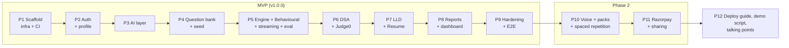

# 08 · Milestone Plan

I changed the suggested order in two places, for these reasons:
- **AI layer (old Phase 4) moves before the question bank (old Phase 3).** Embeddings for the question bank
  need the `EmbeddingProvider`, and building them in the right order avoids a placeholder.
- **The evaluation pipeline moves into Phase 5 (with behavioural mode)**, not Phase 8. Otherwise Phase 5 would
  end with sessions stuck in `EVALUATING`, which breaks the "nothing fake" rule. Phase 8 then covers the full
  report UI, dashboard and rubric admin.

## Universal Definition of Done (applies to every phase)

1. Backend: `./mvnw verify` passes. That covers compile, unit tests (Surefire), integration tests (Failsafe +
   Testcontainers), ArchUnit rules and the JaCoCo coverage gate. I show the output before declaring done.
2. Frontend: `npm run lint`, `npm run typecheck`, `npm test` and `npm run build` pass.
3. `docker compose up --build` brings every service to `healthy`. `GET /api/v1/health` returns 200.
4. The CI workflow covers the phase's changes (it runs on GitHub once the repo is pushed).
5. No `TODO`/`FIXME`/placeholder in production paths. CI greps for these and fails if found.
6. New config is added to `.env.example` and the validated `@ConfigurationProperties`. No secrets are committed
   (CI runs `gitleaks`).
7. README.md and CHANGELOG.md are updated. New endpoints appear in Swagger.
8. **STOP** and wait for your "continue".

Verification commands are shown for PowerShell (Windows) with bash equivalents where they differ. On
Windows PowerShell 5.1, use `curl.exe` (not the `curl` alias).

---

## Phase 1 — Scaffold, infrastructure, CI, health · size M · ✅ done (0.1.0)

> The `worker` container and the `api`/`worker` profiles move to **Phase 4**, where the first real background
> job (`QuestionEmbedJob`) gives the worker something to do. An idle worker would be a placeholder.

**Deliverables**
- `backend/`: Spring Boot 3.5 (Java 25 LTS) with Maven Wrapper. Validated
  `AppProperties`. Virtual threads. `RequestIdFilter` (MDC + response header). JSON logging (Spring Boot structured
  logging, `logstash` format) in containers, with plain text locally. `GlobalExceptionHandler` → RFC 7807 `ProblemDetail` with `code` and `requestId`.
  Security headers + CORS whitelist (Spring Security, all `/api/v1/**` permitted until Phase 2). Request body
  size limit filter. Actuator liveness/readiness with Redis and DB indicators. Prometheus on a separate management
  port. springdoc Swagger UI. `GET /api/v1/health` (public summary).
- Flyway `V1__extensions.sql` (`vector`, `citext`, `pgcrypto`) and `ddl-auto=validate`.
- ArchUnit rules (layering + forbidden process/script APIs) in place from day one.
- `frontend/`: Vite + React + TS + Tailwind + React Query + Router shell. Accessible layout, 404 page, and a live
  API health card. ESLint, Vitest + RTL. nginx image with SPA fallback and an SSE-safe `/api` proxy.
- `docker-compose.yml`: `postgres` (pgvector/pgvector:pg16), `redis`, `api`, `web`, with healthchecks
  and `depends_on: condition: service_healthy`. **Profile `judge0`** (server, workers, db, redis), plus a
  documented spike result for this machine (see R6).
- `.github/workflows/ci.yml`: backend `./mvnw -B verify` (Docker is available on GitHub runners for
  Testcontainers); frontend lint, typecheck, test, build; docker compose build.
- `.env.example`, `.gitignore`, `.gitattributes`, `.editorconfig`, README setup section, CHANGELOG `0.1.0`.

**Tests**
- Unit: `AppProperties` validation (invalid CORS origin or empty values fail), error mapping (AppException →
  ProblemDetail, unknown → 500 without stack trace), RequestIdFilter (propagates a valid incoming id and replaces
  a malformed one).
- Integration (`*IT`, Testcontainers pgvector + Redis): `/api/v1/health` is 200 with components UP and the
  `vector` extension installed. Readiness reports DOWN when Redis is unreachable. CORS preflight from a disallowed
  origin is rejected and an allowed one passes. An oversized body returns 413 ProblemDetail. An unknown route
  returns a 404 ProblemDetail with a request id. Security headers are present.
- Architecture: ArchUnit rules.
- Web: App renders, health card shows UP/DOWN from a mocked API (MSW).

**Verify**
```powershell
.\infra\scripts\verify.ps1          # backend verify + frontend checks + compose up + smoke tests
# or step by step:
cd backend;  .\mvnw.cmd -B verify;  cd ..
cd frontend; npm ci; npm run lint; npm run typecheck; npm test; npm run build; cd ..
copy .env.example .env
docker compose up --build -d --wait
curl.exe -s http://localhost:8080/api/v1/health
start http://localhost:8088                         # web: health card shows API UP
start http://localhost:8080/swagger-ui.html
```

**Phase DoD:** Universal DoD, plus the Judge0 spike outcome is recorded in `docs/09-risks.md` R6.

---

## Phase 2 — Auth, users, roles, profile · size M · ✅ done (0.2.0)

**Deliverables**
- Flyway: users, profiles, companies, user_target_companies, refresh_tokens. Seed companies, the demo user and
  the admin user (seed runs at api startup, idempotent).
- Register/login (`Argon2PasswordEncoder`), access JWT (HS256, 15 min, `kid` header), refresh rotation + family
  reuse detection, logout. Spring Security resource-server config. `/api/v1/admin/**` requires ADMIN.
- Google OIDC (authorization code + PKCE + state stored in Redis). Disabled cleanly when unconfigured.
- Redis rate-limit filter (Lua token bucket; `auth`, `refresh` and `api` classes) plus a per-email+IP login lockout.
- `GET /me`, `PUT /me/profile`, `DELETE /me`.
- Web: login, register, OAuth complete, onboarding/profile form, auth context with in-memory token +
  single-flight refresh, protected routes, admin guard. API types generated with `openapi-typescript`.

**Tests**
- Unit: TokenService (sign/verify/expiry/kid), refresh rotation + reuse detection, password policy validator.
- Integration: register → login → me → refresh (rotated) → old refresh reused → 401 and family revoked → logout.
  Every admin route returns 403 for USER (enumerated from `RequestMappingHandlerMapping`). 6th failed login → 429.
  Google callback with a bad state is rejected (Google endpoints stubbed with WireMock). Passwords never appear in
  logs (OutputCaptureExtension).
- Web: login form validation and the refresh-on-401 interceptor (MSW).

**Phase DoD:** Universal DoD. The demo user can log in through the UI in compose.

---

## Phase 3 — AI provider layer, prompts, structured output · size L

**Deliverables**
- `LlmProvider` interface + Anthropic, OpenAI and Gemini adapters (official Java SDKs, streaming), with
  `MockLlmProvider` + scenario registry.
- Decorators: timeout, retry (exp backoff + full jitter), circuit breaker (Resilience4j inside), Redis cache,
  budget guard, metering (`ai_call_logs` + Micrometer). `LlmProviderFactory`, `FallbackProvider`.
- `EmbeddingProvider` + OpenAI, Gemini, Voyage and mock feature-hashing (1024-d) implementations.
- `PromptRegistry` (front-matter, JMustache, partials, variable checks at boot), `UntrustedContentFramer`,
  `InjectionDetector`, `StructuredOutputService` (JSON Schema generation + validation + repair loop).
- All prompt files from [07-prompts.md](07-prompts.md) and the output records.
- `aiProvider` readiness component (breaker state). Admin `GET /admin/ai-usage`.

**Tests**
- Unit: each decorator with a fake inner provider (retry only on retryable errors; breaker open → half-open →
  closed; cache key stability; cache bypass for streams and temperature > 0; budget rejection). Repair loop
  (invalid → repaired → valid; still invalid after 2 → throws). Framer escape attempts. Registry boot validation.
  Mock scenarios pass schemas.
- Contract tests per real adapter against WireMock with recorded responses, so CI never calls paid APIs.
- `AiSmokeIT` (tag `smoke`): a real call when keys are present, skipped otherwise.

**Phase DoD:** Universal DoD. Mock mode and (if you supply a key) a real provider pass the smoke test.

---

## Phase 4 — Question bank, seed data, admin CRUD, embeddings · size L

**Deliverables**
- Flyway: questions, tags, question_tags, question_companies, dsa_problems, test_cases, question_hints,
  lld_problems, behavioural_prompts, rubrics, audit_logs. HNSW + GIN indexes.
- **Driver generator** (Builder) that produces stdin/stdout harnesses for Python, Java, C++ and JS from the
  function signature (types: int, long, double, boolean, string, arrays and 2D arrays of these; linked
  lists/trees as LeetCode array encoding). `driver_templates` becomes an optional per-question override.
- Seed: **≥30 DSA** (each with ≥2 sample + ≥3 hidden tests, 3 hints, Python reference solution, complexities),
  **≥10 LLD** (requirements, focus areas, reference design + Mermaid), **≥15 behavioural** (competency tags,
  what-good-looks-like, probes), tags, companies, **rubrics v1** for all 4 modes. Seeding is idempotent.
- **Background processing arrives**: JobRunr (PG storage), Spring profiles `api` / `worker`, and a `worker`
  service in docker-compose (same image, `SPRING_PROFILES_ACTIVE=worker`).
- Catalogue API (list/filter/search/detail/similar), admin CRUD with optimistic version (`@Version`), publish
  validation, archive, audit log, reindex job. `QuestionEmbedJob` (JobRunr).
- Web: question browser, detail with "similar questions", admin list + type-specific forms (test case editor,
  hint ladder), rubric viewer.

**Tests**
- Unit: publish-completeness validator per type, driver generator output per language (snapshot), DTO redaction
  (no hidden tests or reference solutions in user DTOs).
- Integration: admin CRUD + audit rows. USER can't see drafts. Similar search returns nearest by cosine with mock
  embeddings on a hand-made fixture. Reindex job fills missing embeddings.
- Data test: seed counts (≥30/10/15). Every DSA problem's tests pass its Python reference solution through Judge0
  (tag `judge0`, run locally).

**Phase DoD:** Universal DoD. Admin creates and publishes a question in the UI, and it shows up in similar
results after embedding.

---

## Phase 5 — Interview engine + Behavioural mode end-to-end + streaming + evaluation · size XL

**Deliverables**
- Flyway: interview_sessions, session_questions, turns, evaluations, competency_scores, usage_monthly,
  topic_stats (basic EWMA).
- Engine: states, `SessionStateFactory`, `InterviewEngine.dispatch`, Redis mutex + optimistic version,
  idempotent answers, retry-turn, end/abandon, `SessionSweepJob` (recurring), quota check (configurable limit).
- Rounds: `BaseRound` + `BehaviouralRound`, `ThresholdDifficultyPolicy`, `QuestionSelector` (seeded),
  `SimilarQuestionRetriever` (RAG into follow-ups).
- Streaming: Redis Streams publisher, `SseEmitter` controller with replay, heartbeat and resync.
- Evaluation pipeline (all steps), `EvaluateSessionJob` with retries, outbox-lite re-enqueue in the sweeper,
  `evaluation/retry`.
- Domain events + listeners (usage, evaluation enqueue, progress).
- Web: new-session page, interview room (chat transcript with `aria-live`, composer, state badge, reconnect
  banner, end/abandon), basic report page (scores, STAR breakdown, evidence, next steps).

**Tests**
- Unit: **parameterised test of every transition** in [04-lld.md §1](04-lld.md#transition-table-source-of-truth-for-tests),
  including invalid ones. Difficulty policy boundaries (4.0 / 7.5 / clamping). Each evaluation pipeline step
  (evidence verification with near-miss quotes, overall computed from weights, N/A competencies, low-confidence
  shrinkage). Selector determinism.
- Integration: full behavioural session over HTTP + an SSE client in the test (create → start → stream question →
  3 answers → follow-ups → EVALUATING → job → COMPLETED → report). Concurrent double-submit → one 202 and one 409.
  Reconnect with Last-Event-ID replays only missed events. Inactivity sweeper transitions.
- Web: `useSessionStream` reducer (dedupe, out-of-order, resync).

**Phase DoD:** Universal DoD. In compose with mock AI, a full behavioural interview runs in the browser and a
report renders. Restarting the api container mid-stream lets the UI recover.

---

## Phase 6 — DSA mode: Monaco, Judge0, hints · size L

**Deliverables**
- `CodeExecutor` Strategy: `Judge0CodeExecutor` (batch submit, polling, status map, comparators) and
  `MockCodeExecutor` (labelled, refuses the prod profile), `code_submissions`, run/submit endpoints.
- `DsaRound`: complexity probing, test-aware follow-ups, objective signals, hint flow (`hint.v1`, sequential
  levels, post-check), turn score blending.
- Admin "validate tests" endpoint.
- Web: split layout (problem | editor | console), Monaco with language switch and per-language drafts, run/submit
  with results panel (hidden tests redacted), hint ladder with penalty notice, mobile layout (tabs at 375px).

**Tests**
- Unit: harness builder per language, Judge0 status mapping, comparators (unordered, float tolerance), hidden
  test redaction, hint order enforcement, hint post-check rejecting code.
- Integration: run/submit with Judge0 stubbed by WireMock. Executor down → 503 and the session continues.
  `judge0`-tagged suite against real Judge0 (local): accepted, wrong answer, TLE, compile error and runtime
  error for Python and Java.

**Phase DoD:** Universal DoD. A DSA interview with real code execution works locally (or via the R6 fallback),
and the report shows tests passed and hints used.

---

## Phase 7 — LLD mode, resume upload/parsing, resume deep-dive · size L

**Deliverables**
- `LldRound` (focus-area coverage tracking, scenario follow-ups). Web: markdown answer + Mermaid editor with live
  preview and inline syntax errors (Mermaid lazy-loaded, `securityLevel: 'strict'`).
- Resumes: upload (magic bytes, size and page caps), `FileStorage` (local volume), `ResumeParseJob` (PDFBox →
  extraction prompt → skill grounding check), parsed-profile editor, activate/delete.
- `ResumeDeepDiveRound`: question generation with project-name verification and seed fallback.

**Tests**
- Unit: LLD focus coverage. PDF validation (fake PDF with a `.pdf` extension rejected). Skill grounding drops
  hallucinated skills. Generated question with an unknown project is dropped.
- Integration: upload → PARSED (mock AI) → deep-dive session end-to-end. **Injection fixture resume** →
  extraction unaffected, integrity flag raised. Delete removes the file from storage.

**Phase DoD:** Universal DoD. All 4 modes are playable end-to-end in compose with mock AI.

---

## Phase 8 — Reports, progress dashboard, rubric admin · size M

**Deliverables**
- Full report page: competency bars with weights, evidence linking to the transcript turn, per-question model
  answers (syntax-highlighted), difficulty path, rubric version and evaluator info, integrity notes, print
  stylesheet.
- Progress API + dashboard: trend lines per competency (Recharts) with a data-table alternative, mode filter, weak
  topics, session history.
- Rubric admin: new version (JSON editor, validation + weight-sum check), activate.
- Demo seed: 3 completed sessions for the demo user.

**Tests**
- Unit: progress aggregation, EWMA update, rubric weight validation.
- Integration: dashboard numbers match seeded evaluations. Activating rubric v2 doesn't change old reports.
- Web: report renders N/A competencies, low-confidence badges, and keyboard navigation to evidence.

**Phase DoD:** Universal DoD. The dashboard shows meaningful trends for the demo user right after
`docker compose up`.

---

## Phase 9 — Hardening & MVP release (v1.0.0) · size M

**Deliverables**
- Rate-limit classes everywhere, per-user daily token budget, cache and breaker metrics.
- Security pass: OWASP ASVS L1 checklist in `docs/security.md`, OWASP dependency-check (Maven) + `npm audit`
  gates, gitleaks, CSP for the web (nginx), cookie flags verified, upload hardening, no user-supplied URLs fetched.
- Observability polish: log masking tests, optional Grafana dashboard in a compose profile.
- **Playwright E2E**: log in as demo → behavioural interview → 3 answers (mock AI) → report → assert scores and
  next steps → dashboard. Runs in CI against compose.
- Accessibility: axe-core in Playwright on key pages, keyboard-only walkthrough, 375px screenshots.
- k6 smoke script (optional): 50 concurrent SSE streams on mock AI, results documented.
- README polish (problem, features, screenshots/GIF, diagrams, decisions, setup, env table, test commands).

**Phase DoD:** Universal DoD + E2E green + zero serious or critical axe violations + tagged `v1.0.0`.

---

## Phase 10 — Phase-2a: Voice, company packs, spaced repetition · size L

- Voice: speech hooks with feature detection, push-to-talk, editable transcript, `inputMode: VOICE`. Optional
  `SttProvider` Strategy (Whisper / Deepgram / mock) behind `/voice/transcribe`.
- Company packs: `question_packs` + items, Amazon LP behavioural pack (≥ 8 LPs), pack-aware selector,
  LP-alignment note in evaluation (prompt v2 + rubric extension).
- Spaced repetition: SM-2 on `topic_stats`, revision queue API and page, "practise this topic" deep link.
- Tests: SM-2 table tests, pack selection, voice hooks with mocked browser APIs, E2E voice-disabled fallback.

## Phase 11 — Phase-2b: Razorpay Pro, shareable reports · size M

- `PaymentProvider` Strategy (Razorpay + mock), plans, subscription create/verify/cancel, webhook with raw-body
  HMAC-SHA256 verification (constant-time compare), idempotency by event id, plan sync listener, quota enforcement
  (Free 3/month, Pro unlimited + voice).
- Share links: create (token shown once, hash stored), revoke, expiry, public redacted report with `noindex`.
- Tests: webhook signature valid/invalid/replayed, subscription state transitions, quota boundary (3rd allowed,
  4th 402), public report has no PII.

## Phase 12 — Final deliverables · size S

- `docs/deploy.md` (Render/Railway + Vercel + managed PG with pgvector + Judge0 options).
- `docs/demo-script.md` (3-minute walkthrough).
- `docs/talking-points.md` (10 hardest questions with strong answers).
- README final pass with screenshots/GIF, diagrams and a "Design decisions" section.

---

## Build order


