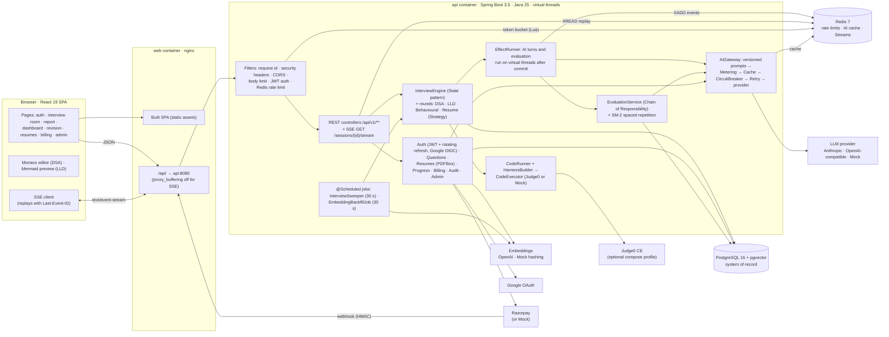
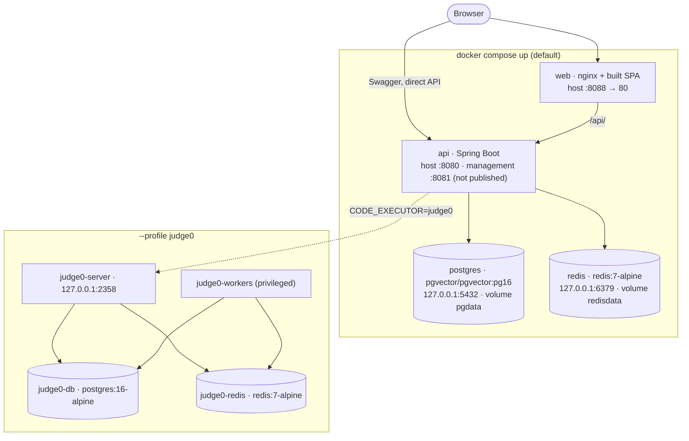
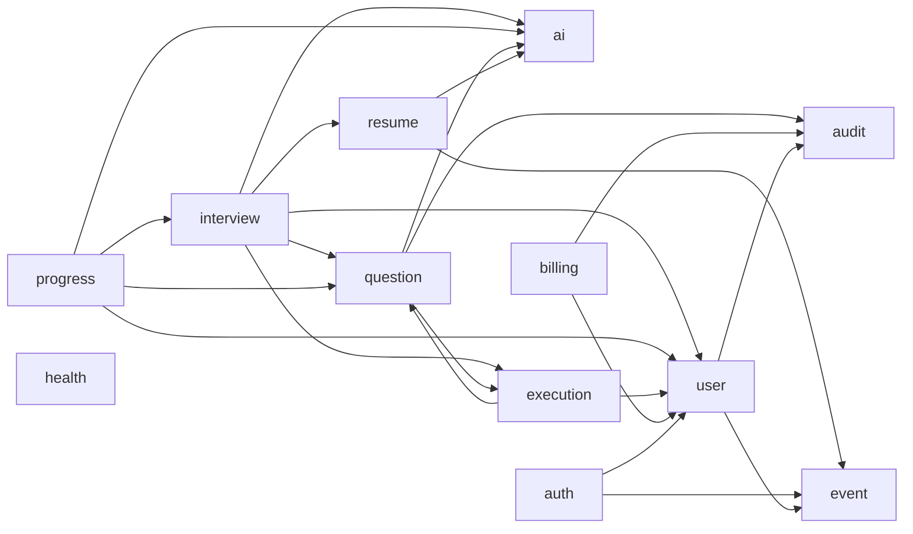
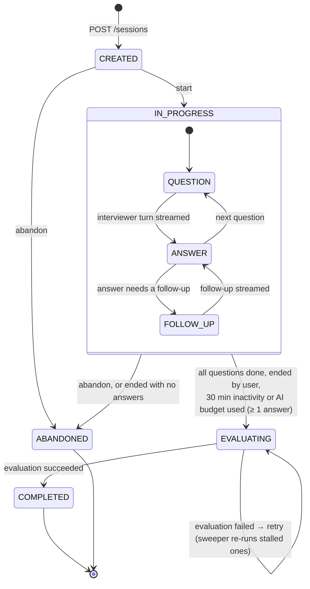
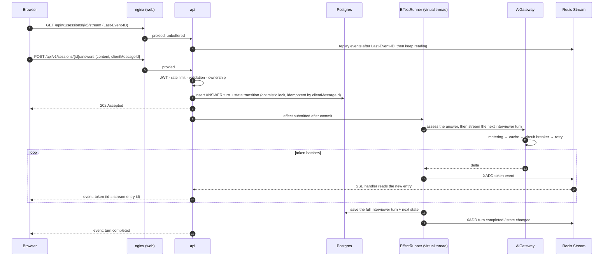
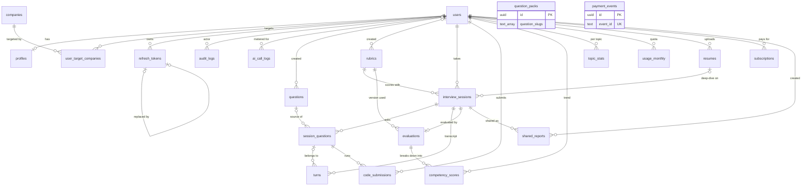
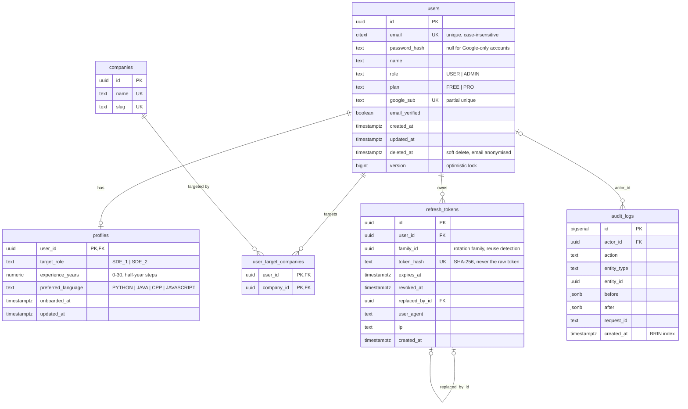
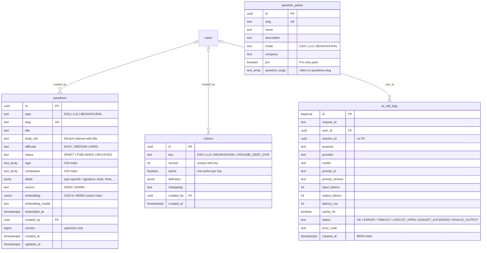
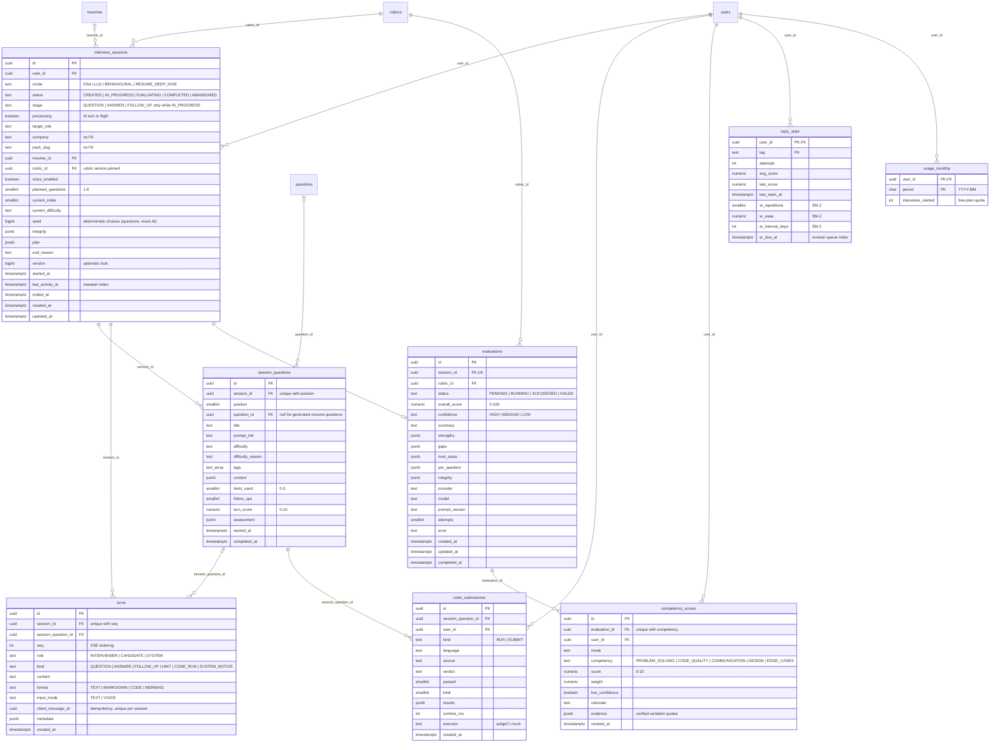
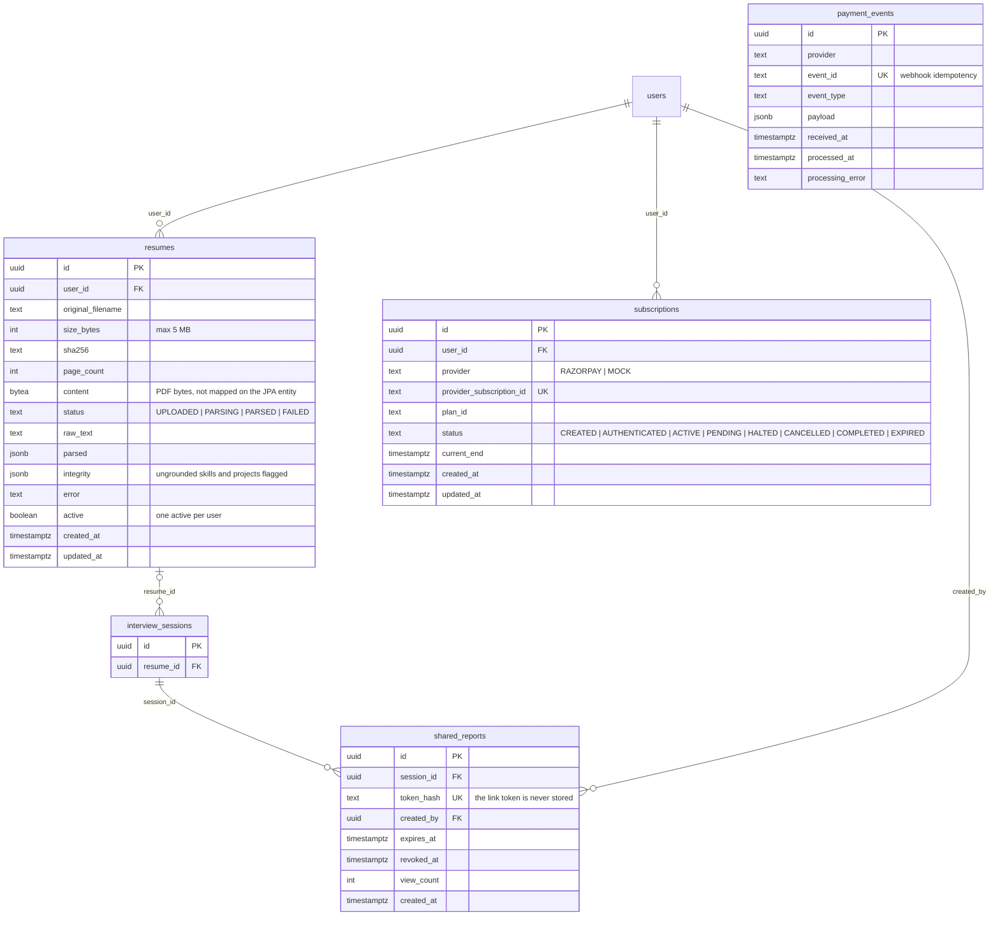

# 10 · Architecture and ER diagrams (as built, v1.0.0)

These diagrams are drawn from the shipped code: the Flyway migrations (`backend/src/main/resources/db/migration`),
the Java packages under `backend/src/main/java/com/aicoach`, `docker-compose.yml` and `frontend/`. The design-time
diagrams in [02-architecture.md](02-architecture.md) §2 and [03-data-model.md](03-data-model.md) are kept for the
reasoning, but where they differ (a separate JobRunr worker, object storage for resumes, per-type question tables),
the diagrams here show what actually runs. The differences are listed in [02-architecture.md](02-architecture.md) §7.

## 1. System architecture

How to read it:

- **One backend deployable.** All work runs inside the `api` container. Slow work (AI turns, evaluation, resume
  parsing) runs on a virtual-thread executor; interview effects start only after their transition has committed. Two
  `@Scheduled` jobs recover anything a
  crash left behind (`InterviewSweeper`) and fill in missing question embeddings (`EmbeddingBackfillJob`).
- **Postgres is the source of truth**; Redis holds only rebuildable state: rate-limit buckets, the AI response
  cache, and the per-session event streams that the SSE endpoint replays.
- **Every external service has a mock** (LLM, embeddings, code execution, payments), so the stack runs with no
  paid keys. The `prod` profile refuses to start with mock code execution or payments.

## 2. Containers (docker compose)

Start order is enforced by health checks: `api` waits for healthy `postgres` and `redis`, and `web` waits for a
healthy `api` (readiness at `:8081/actuator/health/readiness`). Flyway migrates the schema when `api` starts.

## 3. Backend modules and dependencies

Each module is a package under `com.aicoach` with `web` → `service` → `repository` → `domain` layers. Arrows mean
"imports from", computed from the `import` statements in `src/main/java`. Every module except `health` and `event`
also uses `common` (configuration, errors, security, rate limiting, validation); those arrows are left out.

| Module | Responsibility |
|---|---|
| `auth` | Email/password and Google sign-in, JWT access tokens, rotating refresh tokens, login throttling |
| `user` | Account, profile, target companies, account deletion (publishes `UserDeletedEvent`) |
| `question` | Question bank, search, pgvector similar questions, rubrics, admin CRUD, AI usage report, seed data |
| `interview` | Session state machine, rounds, transcript, SSE streaming, evaluation, sweeper, share links |
| `execution` | Harness generation per language, output comparison, Judge0 or mock execution |
| `ai` | `AiGateway`, prompt registry, provider adapters, decorators, structured-output validation, embeddings, `ai_call_logs` |
| `resume` | PDF upload and validation, PDFBox extraction, AI parsing with grounding checks |
| `progress` | Dashboard totals, score history, competency trends, weak topics, revision queue |
| `billing` | Plans and quotas, Razorpay or mock subscriptions, webhook inbox |
| `audit` | Append-only audit log of admin and billing actions |
| `health` | Health endpoint and the pgvector health indicator |
| `common` | Config properties, error handling (RFC 7807), security config, Redis token-bucket rate limiter |

## 4. Interview session lifecycle

`status` and `stage` are columns on `interview_sessions`; a CHECK constraint keeps `stage` non-null exactly when the
status is `IN_PROGRESS`. Transitions use optimistic locking (`version`) with retry on conflict
(`SessionStates.java`, `InterviewEngine.java`).

## 5. Core flow: answer → streamed interviewer turn

If the browser reconnects, it sends the last event id and the server replays only what it missed; if that
position was trimmed from the stream, it sends `resync` and the client reloads the session from Postgres.

## 6. ER diagram

21 tables in five migrations (`V1`–`V5`, plus the repeatable `R__companies`). Conventions used throughout:
UUID primary keys from `gen_random_uuid()`, `timestamptz` timestamps, enumerations stored as `text` with CHECK
constraints (not PostgreSQL ENUM types), and `jsonb` for structured AI output and type-specific question detail.

### 6.1 Overview (keys and relationships)

The overview shows only relationships; every table's columns are in §6.2–§6.5.

`question_packs` and `payment_events` have no foreign keys (see §6.6).

### 6.2 Identity, access and audit (`V2`)

### 6.3 Question bank and AI metering (`V3`)

### 6.4 Interviews, evaluation and progress (`V4`)

### 6.5 Resumes, billing and sharing (`V5`)

### 6.6 References without foreign keys

These columns point at other data by value on purpose; the database does not enforce them.

| Column | Points at | Why there is no FK |
|---|---|---|
| `interview_sessions.pack_slug` | `question_packs.slug` | Packs are reference data; a session keeps its slug even if the pack is renamed or removed. |
| `interview_sessions.company` | a company name | Free-text label for the session, also used with question `companies` tags. |
| `question_packs.question_slugs[]` | `questions.slug` | An array cannot carry a foreign key; slugs are resolved when a session is planned. |
| `questions.companies[]` | company names | Tags for filtering, indexed with GIN. |
| `ai_call_logs.session_id` | `interview_sessions.id` | Logs must survive session deletion; also used for per-session token budgets. |
| `payment_events.payload` | a subscription at the provider | Raw webhook inbox; processed idempotently by `event_id`. |

### 6.7 Notable constraints and indexes

| Table | Constraint or index | Purpose |
|---|---|---|
| `users` | `users_login_method` CHECK | A live account needs a password or a Google identity. |
| `rubrics` | partial unique `(key) WHERE active` | Exactly one active rubric version per round type. |
| `resumes` | partial unique `(user_id) WHERE active` | At most one active resume per user. |
| `interview_sessions` | CHECK `(status = 'IN_PROGRESS') = (stage IS NOT NULL)` | `stage` exists only while in progress. |
| `interview_sessions` | partial index on `(status, last_activity_at)` for in-progress and evaluating | The sweeper's scan. |
| `turns` | unique `(session_id, seq)` and partial unique `(session_id, client_message_id)` | Ordered transcript and idempotent answers. |
| `evaluations` | unique `session_id` | One evaluation per session. |
| `questions` | HNSW on `embedding`, GIN on `tags` / `companies` / full text | Similar questions, filters and search. |
| `audit_logs`, `ai_call_logs` | BRIN on `created_at` | Cheap time-range scans on append-only tables. |
