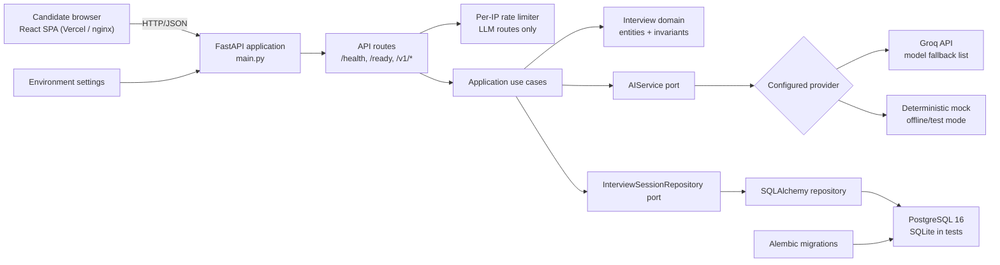
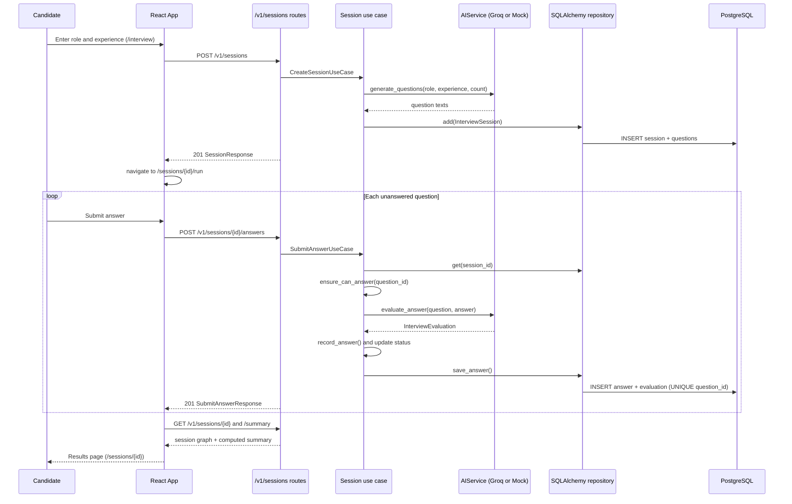
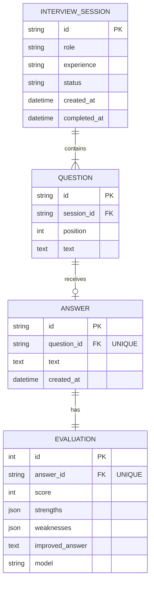
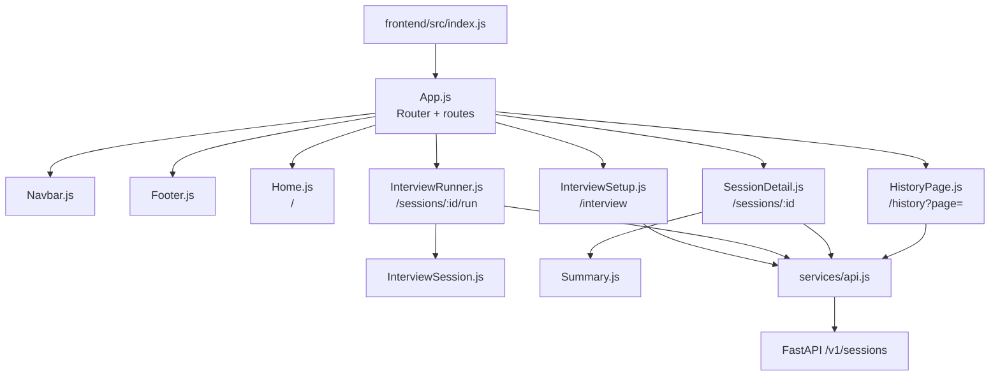
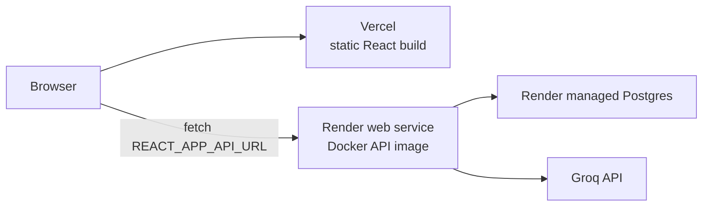

# AI Interview Coach architecture

This document describes the architecture implemented in this repository as of
2026-11-03 (branch `demo-ready`). It is based on the code and deployment files,
not on planned features.

## 1. System overview

AI Interview Coach is a React single-page application backed by a Python
FastAPI service and PostgreSQL. The service uses Groq-hosted LLMs, or a
deterministic offline mock provider when no API key is configured. It has a
clean-architecture shape:

- **API layer** translates HTTP requests and responses, rate limits LLM calls.
- **Application layer** coordinates interview use cases through ports.
- **Domain layer** owns interview entities and invariants.
- **Infrastructure layer** implements AI, persistence, configuration, logging,
  migrations, and seed data.
- **Shared layer** provides application errors and the `Result` type.

The application is open for trial use: there is no authentication or user
identity boundary in the API. Abuse of the LLM-backed endpoints is limited per
client IP instead.



### Runtime boundaries

| Boundary | Implementation | Responsibility |
|---|---|---|
| Browser | `frontend/src` React application | Start sessions, answer questions one at a time, browse history, show results |
| HTTP service | `main.py`, `app/api` | Composition root, CORS, validation, rate limiting, routing, error mapping, health checks |
| Business orchestration | `app/application/interview` | Generate questions, evaluate answers, create/list/read sessions, persist answers, summarize |
| Business model | `app/domain/interview` | Session lifecycle, one-answer rule, completion state, score summaries |
| AI adapter | `app/infrastructure/ai` | Groq JSON calls with timeouts, retries and model fallback, or deterministic mock responses |
| Persistence adapter | `app/infrastructure/persistence` | SQLAlchemy engine and pool, ORM models, repository mapping, transactions |
| Database schema | `migrations` | Versioned tables and constraints for sessions, questions, answers, evaluations |

## 2. Request and data-flow diagrams

### 2.1 Interview flow (what the frontend does)

The React UI keeps no interview state of its own: every step is stored on the
server, so a refresh or a later visit resumes the same session.



If two submissions for the same question race, both pass the in-memory
`ensure_can_answer` check, but the database unique constraint on
`answers.question_id` lets only one insert commit; the other becomes a 409.

### 2.2 Stateless endpoints

`POST /v1/interview/generate-questions` and `POST /v1/interview/evaluate` call
the same use-case layer and AI port but store nothing. They are kept for API
clients that only want a one-off evaluation. The frontend no longer uses them.

### 2.3 Layer dependency rule

Dependencies point inward. The domain and application layers do not import
FastAPI, SQLAlchemy, Groq, or infrastructure modules;
`tests/unit/test_architecture.py` enforces this rule.

```mermaid
flowchart TB
    API["API<br/>FastAPI routes, dependencies, handlers, rate limit"]
    APP["Application<br/>use cases, ports, DTOs"]
    DOMAIN["Domain<br/>InterviewSession, Question, Answer, Evaluation"]
    INFRA["Infrastructure<br/>Groq/Mock, SQLAlchemy, settings, logging"]
    SHARED["Shared<br/>AppError, Result"]

    API --> APP
    API --> SHARED
    APP --> DOMAIN
    APP --> SHARED
    INFRA -. implements .-> APP
    INFRA --> DOMAIN
    API -. invokes adapters through app.state/dependencies .-> INFRA
```

## 3. Backend architecture

### Entry points and composition

1. `main.py:create_app()` loads `Settings`, configures JSON logging, builds the
   SQLAlchemy engine/session factory, selects the AI provider, creates the rate
   limiter, installs CORS, registers routers, and registers exception handlers.
2. `main.py:app` is the process-level ASGI application served by uvicorn.
3. `scripts/start.sh` is the container entrypoint: `alembic upgrade head`, then
   the optional demo seed (`SEED_DEMO_DATA=true`), then uvicorn with
   `--proxy-headers` so the rate limiter sees the real client IP behind
   Render's proxy.
4. `app/infrastructure/seed.py` is an idempotent seed utility that always uses
   the deterministic mock provider and does nothing if any session exists.

### API surface

| Route | Purpose | Storage | Rate limited |
|---|---|---|---|
| `GET /health` | Liveness and application version | None | No |
| `GET /ping` | Legacy liveness alias (hidden from OpenAPI) | None | No |
| `GET /ready` | Database connectivity (503 if down) and active LLM provider | Reads DB | No |
| `POST /v1/sessions` | Create a session with 1–10 generated questions | Session + questions | Yes |
| `GET /v1/sessions?limit=&offset=` | Newest-first offset pagination (`limit` 1–100) | Sessions | No |
| `GET /v1/sessions/{session_id}` | Retrieve a session aggregate | Session graph | No |
| `POST /v1/sessions/{session_id}/answers` | Evaluate and persist one answer | Answer + evaluation | Yes |
| `GET /v1/sessions/{session_id}/summary` | Compute aggregate metrics | Session graph | No |
| `POST /v1/interview/generate-questions` | Generate questions, not stored | None | Yes |
| `POST /v1/interview/evaluate` | Evaluate one answer, not stored | None | Yes |

All request DTOs are Pydantic models. Errors are normalized to:

```json
{
  "error": {
    "code": "validation_error",
    "message": "Request validation failed",
    "details": {}
  }
}
```

`AppError` (including `RateLimitedError`, which adds a `Retry-After` header),
request validation errors, Starlette HTTP errors, and unexpected exceptions are
handled centrally in `app/api/error_handlers.py`. Unhandled errors return a
generic 500 without internals.

### Rate limiting

`app/api/rate_limit.py` implements a sliding 60-second window per client IP
(`RATE_LIMIT_PER_MINUTE`, default 20, `0` disables). It is a FastAPI dependency
on the four LLM-backed routes only, because those are the ones that cost money
and latency. Counters live in process memory: with N API instances a client
can make up to N times the limit. The upgrade path for horizontal scaling is
the same interface backed by a shared store (Redis `INCR` + `EXPIRE`).

### Domain model



The domain aggregate enforces:

- a session has at least one non-empty question;
- a question can be answered at most once;
- completed sessions cannot accept answers;
- a session becomes `completed` after all questions are answered;
- scores must be 1–10 (the Groq adapter clamps model output into that range);
- summaries are computed from stored answers, not stored.

The database repeats the one-answer invariant with a unique
`answers.question_id` constraint, which protects against concurrent
submissions. `(session_id, position)` is also unique, and `status` and
`created_at` are indexed for the history list.

## 4. Frontend architecture

The frontend is a Create React App single-page application with React Router.
Every page is addressable by URL, so it survives a refresh.



- `InterviewSetup` creates a session and navigates to the runner.
- `InterviewRunner` loads the session, shows the first unanswered question and
  submits answers one at a time; it resumes where the user left off.
- `HistoryPage` lists sessions with pagination (page number in the URL),
  status, progress and average score, and a Continue link for unfinished ones.
- `SessionDetail` shows the server-computed summary and per-question feedback.

`services/api.js` uses `REACT_APP_API_URL` (inlined at build time), otherwise
the page's own origin in production builds and `http://localhost:8000` in
development. It turns the API's error shape into an `ApiError` whose message is
shown inline (for example the rate-limit message).

## 5. Technology stack

### Runtime and application

| Area | Technology | Evidence |
|---|---|---|
| Backend language | Python `>=3.10` (Docker image Python 3.11) | `pyproject.toml`, `Dockerfile` |
| HTTP framework | FastAPI `0.162.0` | `requirements.txt`, `main.py` |
| ASGI server | Uvicorn `0.54.0` | `requirements.txt`, `scripts/start.sh` |
| Validation/settings | Pydantic `2.14.2`, pydantic-settings `2.15.0` | DTOs and `settings.py` |
| Frontend | React `19`, React Router DOM `7` | `frontend/package.json` |
| Frontend tooling | Create React App / `react-scripts` `5.0.1` | `frontend/package.json` |
| HTTP client | Browser `fetch` | `frontend/src/services/api.js` |

### AI

| Technology | Use |
|---|---|
| Groq Python SDK `1.7.0` | Chat completions with JSON response format |
| `GROQ_MODELS` list | Tried in order; the next model is used on a retired model, exhausted retries, an API error or unusable JSON. An auth error stops immediately |
| `MockAIService` | Deterministic local/test provider when `LLM_PROVIDER=mock`, or `auto` without a key |

### Persistence and data

| Technology | Use |
|---|---|
| SQLAlchemy `2.0.55` | Engine with pool settings and `pool_pre_ping`, sessions, ORM models, repository adapter |
| Alembic `1.20.1` | Versioned schema migrations, run on container start |
| PostgreSQL 16 via `psycopg[binary]` `3.3.6` | Production database (`postgres://` URLs from Render are normalised) |
| SQLite | Default test database (a fresh file per test) |

### Operations and delivery

| Technology/file | Role |
|---|---|
| `Dockerfile` | Multi-stage API image: dependencies in a builder venv, runtime copies only the venv and code, non-root user, `HEALTHCHECK` on `/health` |
| `frontend/Dockerfile` | Multi-stage: Node builds the React bundle, nginx serves it with SPA fallback (`frontend/nginx.conf`) |
| `docker-compose.yml` | Local stack: Postgres 16 + API + web |
| `render.yaml` | Render Blueprint: Docker web service + managed Postgres, health check on `/ready` |
| `frontend/vercel.json` | Vercel static build of the frontend with SPA rewrites |
| `.github/workflows/ci.yml` | CI: ruff, pytest on Postgres, frontend tests + build, both Docker builds, gitleaks |
| JSON Lines logging | Structured stdout logging for platform log ingestion |

### Quality

| Tool | Use |
|---|---|
| Pytest `9.2.0` | Unit, use-case, API and migration tests (SQLite by default, Postgres with `TEST_DATABASE_URL`) |
| Ruff `0.17.3` | Python linting and import sorting |
| HTTPX `0.28.1` | FastAPI test client transport |
| Jest + React Testing Library | Frontend tests for the API client, routes, history and runner |
| gitleaks | Secret scan in CI |

## 6. Configuration and deployment

Environment variables loaded by `Settings` (see `.env.example`):

- `APP_NAME`, `APP_ENV`, `APP_VERSION`, `ENABLE_DOCS`;
- `LLM_PROVIDER`, `GROQ_API_KEY`, `GROQ_MODELS`, `LLM_TIMEOUT_SECONDS`,
  `LLM_MAX_RETRIES`;
- `DATABASE_URL`, `DB_POOL_SIZE`, `DB_MAX_OVERFLOW`,
  `DB_POOL_TIMEOUT_SECONDS`, `DB_CONNECT_TIMEOUT_SECONDS`, `SEED_DEMO_DATA`;
- `RATE_LIMIT_PER_MINUTE`;
- `CORS_ORIGINS` (comma-separated).

The frontend reads one build-time variable, `REACT_APP_API_URL`.

Provider resolution:

```text
LLM_PROVIDER=mock              -> MockAIService
LLM_PROVIDER=groq              -> GroqAIService
LLM_PROVIDER=auto + API key    -> GroqAIService
LLM_PROVIDER=auto without key  -> MockAIService
```

Deployment topology:



The API and the frontend are separate deployables. The frontend calls the API
cross-origin, so the API's `CORS_ORIGINS` must contain the Vercel URL. Render
only routes traffic to a new deploy once `/ready` returns 200.

`/health` checks nothing but the process (used by the Docker `HEALTHCHECK`),
so a slow database never gets a healthy container restarted. `/ready` checks
the database and is what the platform uses to decide whether to send traffic.

## 7. Source and configuration inventory

Generated artifacts (`frontend/build`, `frontend/node_modules`, `.venv`,
`__pycache__`, `.pytest_cache`, local `*.db` files) are excluded.

### Repository root

| File | Architectural use |
|---|---|
| `main.py` | FastAPI composition root and ASGI app |
| `requirements.txt` / `requirements-dev.txt` | Runtime and test/lint dependencies (pinned) |
| `pyproject.toml` | Package metadata, Python floor, pytest and Ruff configuration |
| `Dockerfile`, `.dockerignore` | Multi-stage API image |
| `scripts/start.sh` | Container entrypoint: migrate, seed, serve |
| `docker-compose.yml` | Local Postgres + API + web stack |
| `render.yaml` | Render Blueprint (API + Postgres) |
| `alembic.ini` | Alembic migration configuration |
| `.env.example` | Every setting, with safe defaults |
| `.github/workflows/ci.yml` | Continuous integration |
| `README.md`, `DEMO.md`, `CHECKPOINT.md` | Overview and setup, demo script and Q&A, build log |
| `.gitleaksignore` | The two known, already-public secret-scan findings |

### Backend package

| File | Architectural use |
|---|---|
| `app/api/dependencies.py` | Per-request DB sessions, repository, and AI dependency providers |
| `app/api/error_handlers.py` | Common HTTP error response mapping |
| `app/api/rate_limit.py` | Sliding-window per-IP limiter and its FastAPI dependency |
| `app/api/routes/__init__.py` | Router aggregation and prefixes |
| `app/api/routes/health.py` | Liveness, legacy ping, and readiness probes |
| `app/api/routes/sessions.py` | Persistent session endpoints |
| `app/api/routes/interview.py` | Stateless question-generation and evaluation endpoints |
| `app/application/interview/dto.py` | Pydantic request and response models |
| `app/application/interview/interfaces.py` | `AIService` and `InterviewSessionRepository` ports |
| `app/application/interview/use_cases.py` | Interview orchestration and `Result`-based error flow |
| `app/domain/interview/entities.py` | Session aggregate, questions, answers, evaluations, summaries, invariants |
| `app/infrastructure/ai/__init__.py` | AI provider factory |
| `app/infrastructure/ai/groq_service.py` | Groq adapter, prompts, model fallback, JSON parsing |
| `app/infrastructure/ai/mock_service.py` | Deterministic offline AI adapter |
| `app/infrastructure/config/settings.py` | Environment-backed settings and provider/database parsing |
| `app/infrastructure/logging/logger.py` | JSON logging formatter and configuration |
| `app/infrastructure/persistence/database.py` | Engine, pooling, SQLite settings, session factory, DB ping |
| `app/infrastructure/persistence/models.py` | SQLAlchemy persistence schema mappings |
| `app/infrastructure/persistence/repository.py` | ORM/domain mapping and transactions |
| `app/infrastructure/seed.py` | Idempotent mock-backed demo data |
| `app/shared/errors.py` | Typed error hierarchy (validation, not found, conflict, rate limited, ...) |
| `app/shared/result.py` | Generic success/error result wrapper |

### Database migrations

| File | Architectural use |
|---|---|
| `migrations/env.py` | Loads settings, exposes SQLAlchemy metadata, runs online/offline migrations |
| `migrations/versions/0001_initial_schema.py` | Creates the four interview tables and constraints |

### Frontend

| File | Architectural use |
|---|---|
| `frontend/package.json`, `package-lock.json` | Dependencies, scripts, Jest module mapping for React Router 7 |
| `frontend/.env.example` | `REACT_APP_API_URL` example |
| `frontend/Dockerfile`, `nginx.conf` | Build with Node, serve with nginx |
| `frontend/vercel.json` | Vercel build and SPA rewrites |
| `frontend/src/App.js` | Router and routes |
| `frontend/src/services/api.js` | Fetch-based API client and `ApiError` |
| `frontend/src/components/*.js` | Pages (`Home`, `InterviewSetup`, `InterviewRunner`, `HistoryPage`, `SessionDetail`) and pieces (`InterviewSession`, `Summary`, `Navbar`, `Footer`) |
| `frontend/src/**/*.test.js` | Jest tests |

### Tests

| File | Architectural use |
|---|---|
| `tests/conftest.py` | SQLite/PostgreSQL fixtures, migrations, FastAPI test client |
| `tests/fakes.py` | In-memory AI and repository test doubles |
| `tests/unit/test_architecture.py` | Enforces the inward dependency rule |
| `tests/unit/test_domain.py` | Domain invariants and summaries |
| `tests/unit/test_use_cases.py` | Application orchestration and failure behavior |
| `tests/unit/test_ai_services.py` | Mock provider and Groq fallback behavior |
| `tests/unit/test_settings.py` | Environment parsing and URL normalization |
| `tests/unit/test_rate_limit.py` | Sliding-window limiter |
| `tests/api/test_sessions_api.py` | Session API, readiness, CORS, conflicts, concurrency, error contracts |
| `tests/api/test_rate_limit_api.py` | 429 response shape and `Retry-After` |
| `tests/api/test_migrations_and_seed.py` | Migration-vs-models drift and seed behavior |

## 8. Known boundaries and next steps

These are limits of the current implementation, not features that exist:

- No authentication, users, or per-user session ownership: every visitor sees
  the same session history. An unfinished auth feature exists only on a local
  branch and is not part of this code.
- Rate-limit counters are per process; multiple instances need a shared store.
- LLM calls run inside the request. A slow model holds a worker for up to
  `LLM_TIMEOUT_SECONDS` per attempt; a job queue would be the next step at
  higher load.
- Offset pagination is simple and fine for this data size; keyset pagination
  on `(created_at, id)` would scale better for deep pages.
